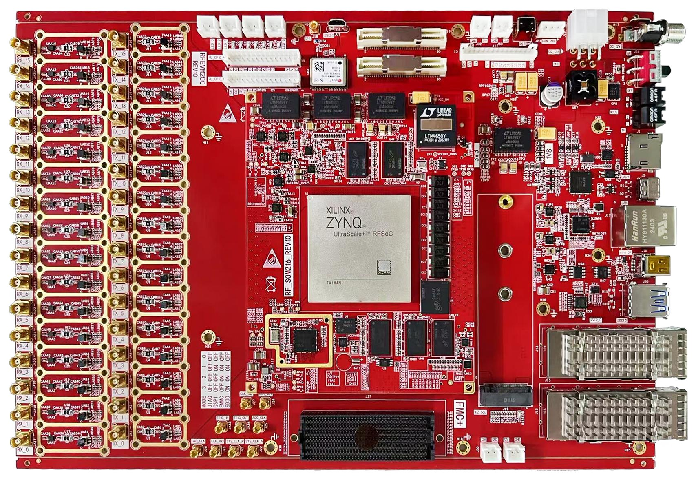

# Front Matter

[Switch to 中文](../../zh/fpga-tutorial/00-front-matter.md)

> This chapter is translated from the Chinese source PDF. Figures and UI screenshots retain their original labels so that they match the hardware and software.  
> Source PDF: `RFEVM216开发平台FPGA教程.pdf`  
> Source pages: 1-6

## Source PDF page 1

RFEVM216 Development Platform  
FPFA Basic Development Tutorial  
Rev. 1.0

### Figures

---

## Source PDF page 2

Revision Record  
Version Revision Date Revision Content  
1.0 May 27, 2025 V1.0 Initial Version

---

## Source PDF page 3

Contents  
1 / 223  
Contents  
1 Introduction to the Development Board ....................................................................................................... 5  
2 Experimental Environment Setup ................................................................................................... 8  
Software Environment ....................................................................................................... 8  
Hardware Environment ....................................................................................................... 8  
Vitis Project Description ...............................................................................................8  
3 PL-side Peripherals .......................................................................................................... 9  
3.1 LED Breathing Light Experiment .....................................................................................9  

3.1.1 Hardware Design ...................................................................................... 9  
3.1.2 Hardware Project Setup ............................................................................ 10  
3.1.3 Download Verification .................................................................................... 24  
3.2 PL-side DDR4 Read/Write Experiment ......................................................................... 26  
3.2.1 Hardware Design .................................................................................... 28  
3.2.2 Hardware Project Setup ............................................................................ 29  
3.2.3 Download Verification .................................................................................... 45  
3.2.3 Reference Documents .................................................................................... 48  

3.3 GTY Transceiver Bit Error Rate Test IBERT Experiment .................................................49  
3.3.1 Hardware Introduction .................................................................................... 49  
3.3.2 Hardware Project Setup ............................................................................ 50  
3.3.3 Download Verification .................................................................................... 62  
3.3.4 Reference Documents .................................................................................... 68  
4 PS-side Peripherals .........................................................................................................69  
4.1 IPI Design Establishment ..........................................................................................69  
4.1.1 Hardware Project Setup ........................................................................... 69  

4.1.2 Software Engineering Setup ........................................................................... 89  
4.2 Experience ARM, Bare-Metal Output 'Hello World' .................................................. 94

---

## Source PDF page 4

Table of Contents  
2 / 223  
4.2.1 Hardware Introduction .................................................................................... 95  
4.2.2 Vitis Program Development .............................................................................95  
4.2.3 Program Solidification ................................................................................. 103  
4.3 PS-side RTC Interrupt Experiment ...........................................................................110  
4.3.1 Software Design ..................................................................................112  
4.3.2 Download Verification ..................................................................................115  
4.4 PS-side IIC Usage .................................................................................117  
4.4.1 Hardware Design ...................................................................................117  

4.4.2 Software Design ..................................................................................118  
4.4.3 Download Verification .................................................................................. 121  
4.5 Use of lwIP for PS Side Ethernet ....................................................................123  
4.5.1 Hardware Design .................................................................................. 123  
4.5.2 Software Design .................................................................................. 125  
4.5.3 Download Verification .................................................................................. 133  
4.5.4 Reference Documents ................................................................................. 135  
4.6 Use of DisplayPort on PS Side .................................................................... 135  

4.6.1 Hardware Design .................................................................................. 135  
4.6.2 Software Design .................................................................................. 136  
4.6.3 Download Verification ........................................................................ 137  
4.7 SD Card Read and Write TXT Text Experiment .................................................. 139  
4.7.1 Hardware Design .................................................................................. 139  
4.7.2 Software Design .................................................................................. 140  
4.7.3 Download Verification ........................................................................ 151  
4.7.4 Reference Documents ........................................................................ 152  

4.8 USB Slave Function Test Based on PS ........................................................ 152  
4.8.1 Hardware Design .................................................................................. 153  
4.8.2 Software Design .................................................................................. 153  
4.8.3 Download Verification .................................................................................. 155

---

## Source PDF page 5

Table of Contents  
3 / 223  
4.8.4 References .................................................................................. 157  
5 PS and PL Interconnection ........................................................................ 158  
5.1 Use of EMIO on PS Side .................................................................... 159  
5.1.1 Hardware Project Setup ................................................................ 159  
5.1.2 Software Project Setup ................................................................ 166  
5.1.3 Download and Verification ......................................................... 177  
5.2 Use of AXI GPIO on PL Side ................................................................. 177  
5.2.1 Hardware Project Setup ................................................................ 178  

5.2.2 Software Project Setup .......................................................................... 184  
5.2.3 Download Verification .................................................................................. 187  
5.3 PS Side Reading and Writing PL Side Registers ................................................................. 188  
5.3.1 Hardware Project Setup .......................................................................... 188  
5.3.2 Software Project Setup .......................................................................... 195  
5.3.3 Download Verification .................................................................................. 198  
5.4 AXI-DMA Loopback Test ...........................................................................202  
5.4.1 Hardware Project Setup .......................................................................... 204  
5.4.2 Software Project Setup .......................................................................... 212  

5.4.3 Download Verification .................................................................................. 217  
6 FAQs ...............................................................................................................220

---

## Source PDF page 6

[No extractable text on this page.]
