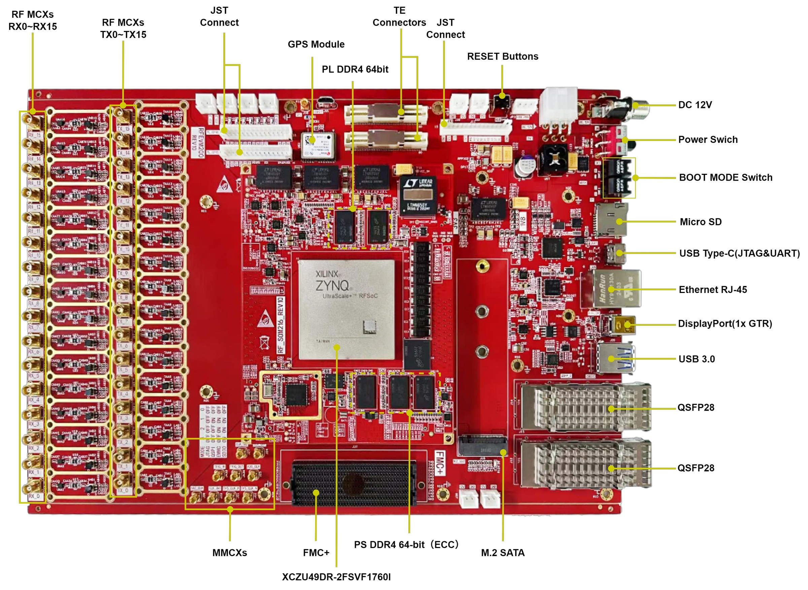

# 1. Development Board Introduction

[Switch to 中文](../../zh/fpga-tutorial/01-board-introduction.md)

The RFEVM216 development board consists of the RFSOM216 SoM board and a carrier board, which are connected by a high-speed board-to-board connector.
The RFSOM216 SoM board uses Xilinx's ZynqTM UltraScale+TM RFSoc Gen3 series ZU49DR FPGA as the main chip. It supports 16 channels of 14-bit RF-ADC with a maximum sampling rate of up to 2.5GSPS, and 16 channels of 14-bit RF-DAC with a maximum sampling rate of up to 9.85GSPS. This can reduce the complexity of the RF signal processing chain, maximize input/output channel density without sacrificing bandwidth, utilize heterogeneous processing capabilities, and achieve lower power consumption (by removing the ADC/DAC components and eliminating the FPGA-to-analog interface power consumption).
The Zynq UltraScale+ device provides an ARM 4-core Cortex-A53 processing subsystem, dual-core Cortex-R5F, and UltraScale+ programmable logic, which can provide a comprehensive RF signal chain to meet the needs of wireless, cable TV access, test and measurement, early warning/radar, and other high-performance RF applications.
The carrier board extends abundant peripheral interfaces for the SoM board, including one USB 3.0 interface, one Gigabit Ethernet interface, one JTAG/UART interface, one TF card interface, and two QSFP 4G optical interfaces.

Figure 1 Physical Image of RFEVM216 Development Board
The diagram below shows the structural schematic of the entire development system:
Figure 2 RFEVM216 Development Board
Through this schematic, we can see the interfaces and functions included in the RFEVM development platform.

- RFSOM216 Core Board

Consists of ZU49DR + 4GB DDR4 (PS with ECC) + 4GB DDR4 (PL with ECC) + 1Gb QSPI Flash. Additionally, the core module provides dual crystal oscillator clock sources: a single-ended 33.3333MHz active crystal oscillator for the PS system, and a 32.76MHz crystal driving the RFSOC internal RTC circuit.

- M.2 Interface

A PCIe x2 standard M.2 interface for connecting an M.2 SSD.

- USB3.0 Interface

A USB3.0 interface supporting HOST and SLAVE modes.

- Gigabit Ethernet Interface

A 10M/100M/1000M Ethernet RJ45 interface for data exchange with computers or other network devices.

- JTAG & UART Interface

The JTAG & UART debug interface is a Type-C interface. JTAG and UART share this interface for FPGA program download and debugging.

- Micro SD Card Slot

- Micro SD Card Slot

One Micro SD card slot for storing the operating system image and file system.

- QSFP28 Optical Interface

Two QSFP28 optical interfaces.

- Expansion IO

Three sets of expansion IOs, two sets of PL-side expansion IOs, and one set of PS-side expansion IOs, available for user customization.

- LED Lights

Four expandable LED through-hole sockets, available for user customization.

- FMC+

One FMC+ connector for connecting expansion daughter cards.

- MINI_DP

One MINI_DP interface.

- Button

One reset button.
