# 4.5 LWIP for PS-side Ethernet

[Switch to 中文](../../../zh/fpga-tutorial/04-ps-peripherals/05-lwip-ethernet.md)

[Back to chapter overview](index.md)

LWIP is a small open-source TCP/IP protocol stack developed by Adam Dunkels and others at the Swedish Institute of Computer Science (SICS). It is one implementation of TCP/IP. LWIP is a lightweight IP protocol that can run with or without operating system support. The focus of LWIP's implementation is to reduce RAM usage while maintaining the main functions of the TCP protocol. It only requires about a dozen KB of RAM and around 40K of ROM to run, making the LWIP protocol stack suitable for use in low-end embedded systems.
Here, we use the Lwip Echo Server template provided with Vitis software to understand the use of LWIP.

## 4.5.1 Hardware Design

The RFEVM216 development board has a PS-side RJ45 Ethernet interface for connecting to an Ethernet cable. Its schematic diagram is shown as follows:

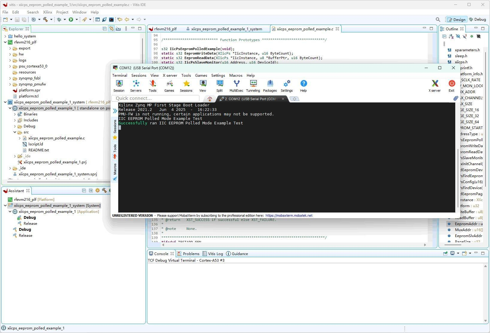

Figure 13 RJ45 Interface Schematic
Ethernet data transmission cannot do without the support of the Ethernet PHY (Physical Layer) chip. The PHY chip used on the RFEVM216 development board is the DP83867ISRGZ chip from Texas Instruments, and part of the schematic is shown in the figure:

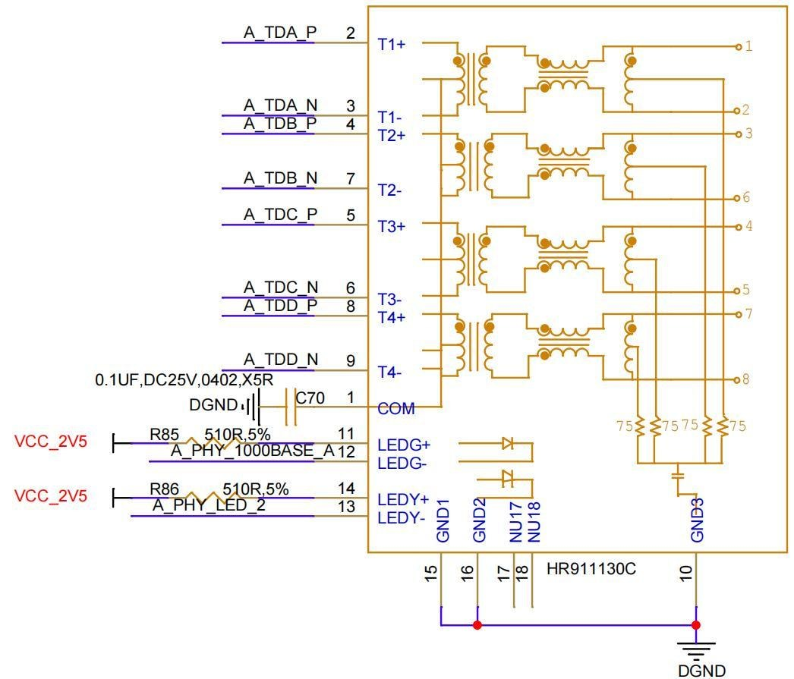

Figure 14 DP83867ISRGZ Schematic

## 4.5.2 Software Design

Add the lwip library in the BSP library files
Double-click platform.spr, select Board Support Package, and click Modify BSP Settings...

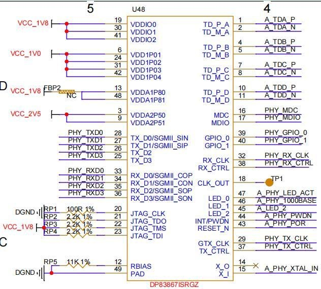

Enable the lwip library, click OK
Compile platform

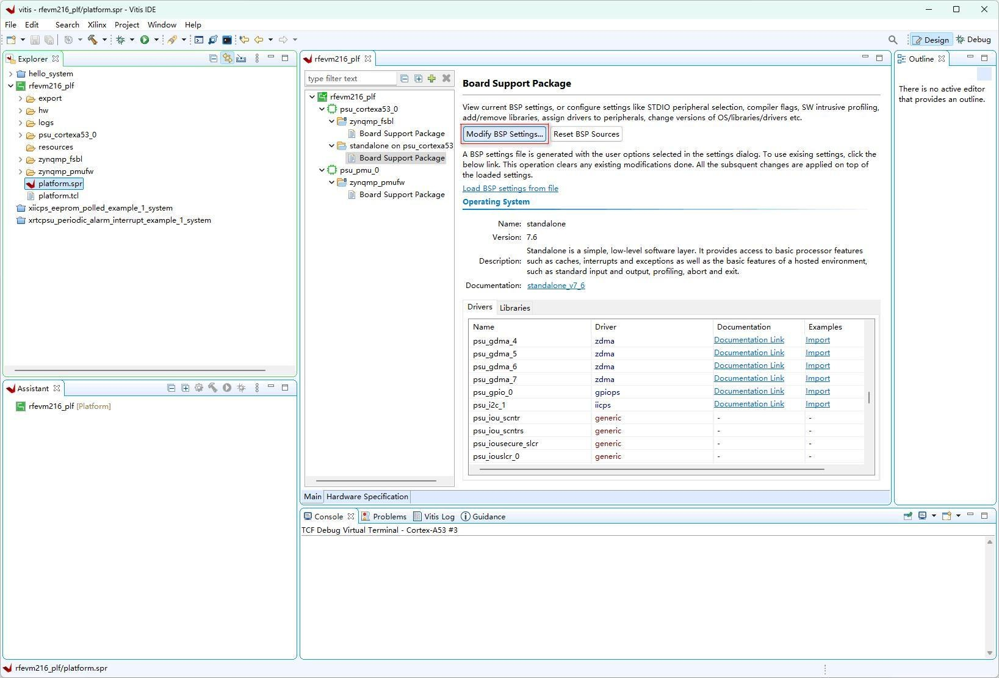

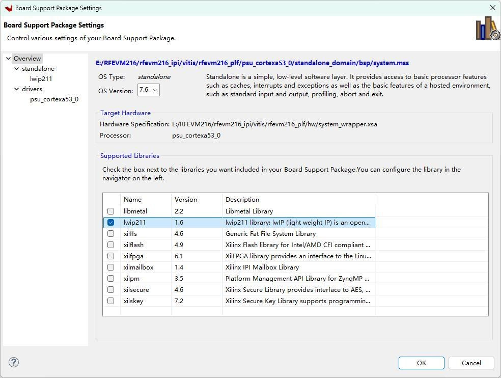

Create a new application File->New->Application Project
Click Next

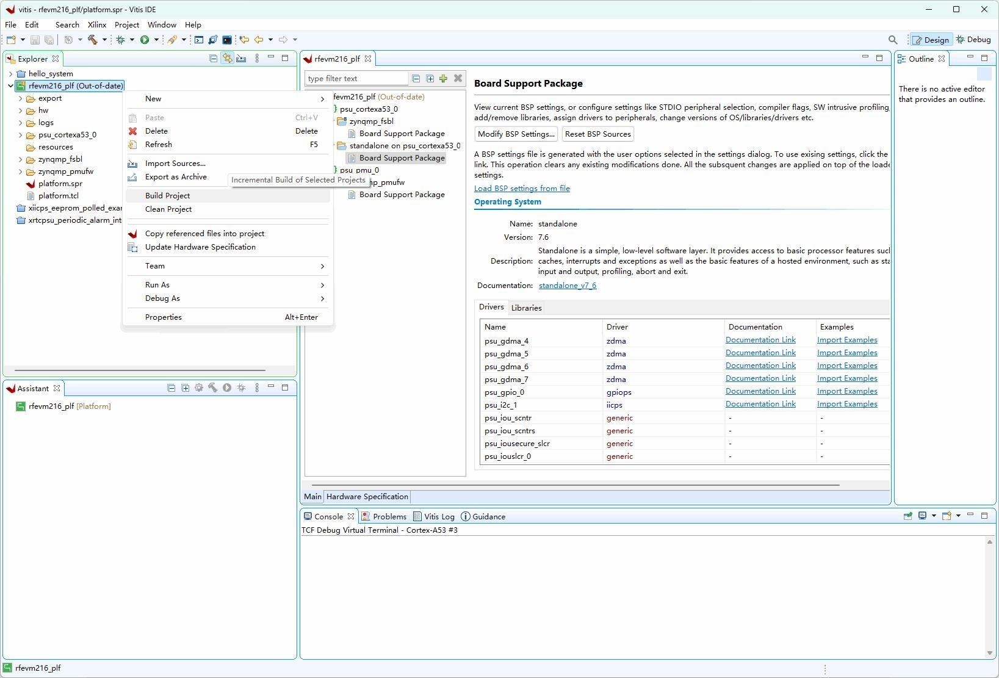

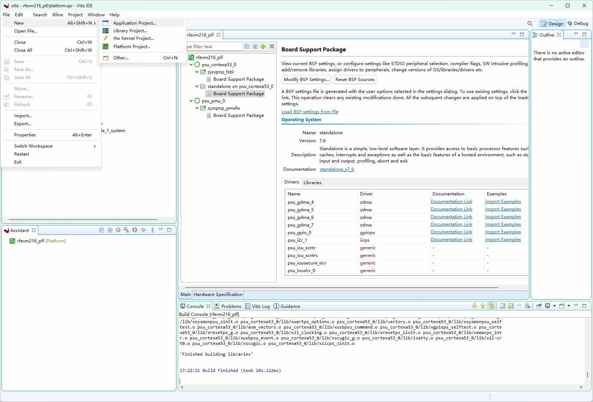

Click Next

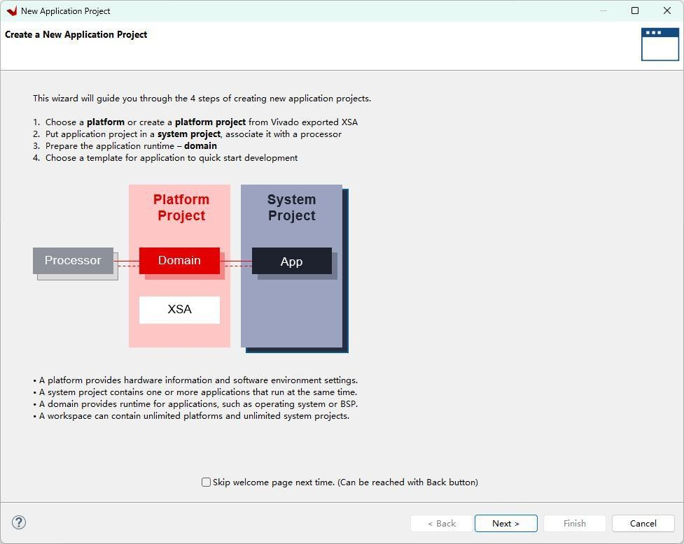

Set the APP name, click Next

Click Next

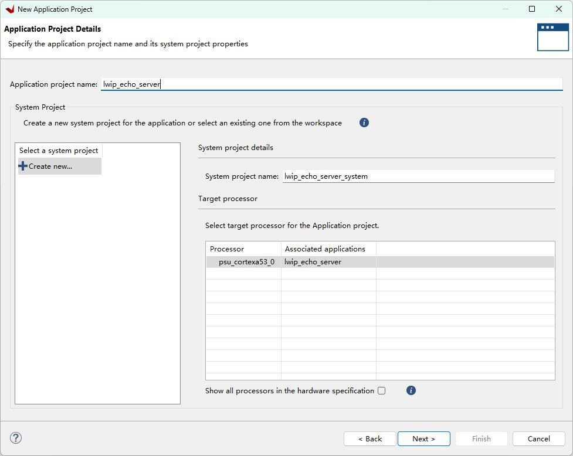

Select the Lwip Echo Server template and click Finish.
We modify the IP and subnet of the board so that the board and the PC are on the same subnet.

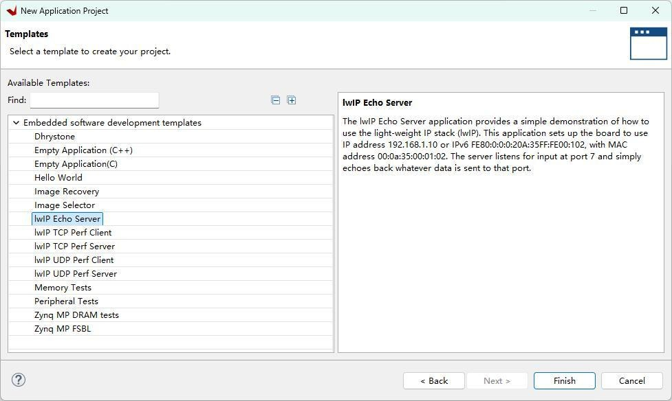

After making modifications, save the file, right-click the lwip_echo_server project, and click Build Project

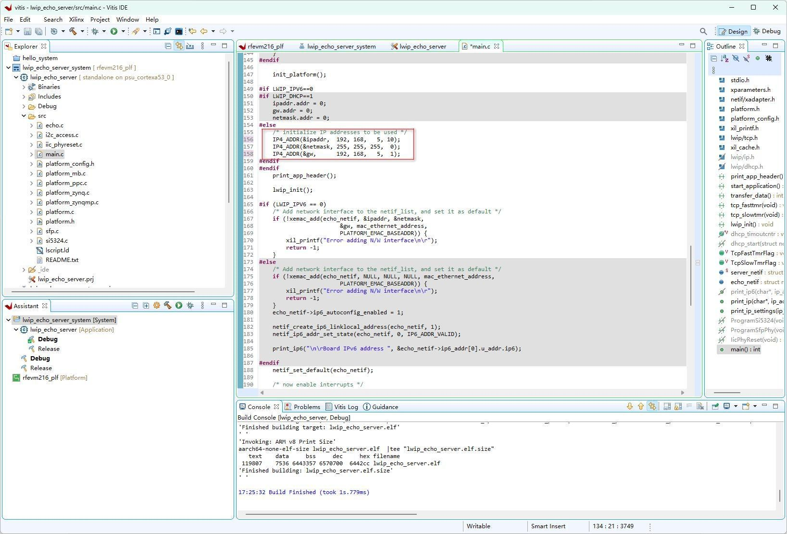

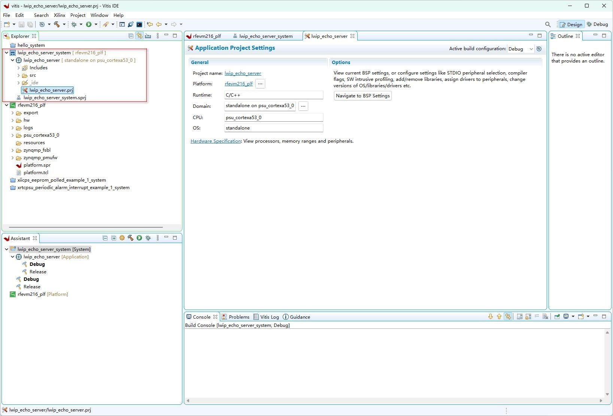

## 4.5.3 Download Verification

1. Here we connect the PC and the RFEVM development board using a gigabit Ethernet cable, then power on the board.
2. The IP addresses of the PC and the RFEVM must be in the same subnet to communicate with each other.

Default configuration of RFEVM216 Ethernet:
MAC address: 00:0a:35:00:01:02
IP address: 192.168.5.10
Subnet mask: 255.255.255.0
Gateway: 192.168.5.1

3. Right-click the lwip_echo_server project and select Run As->Run Configuration

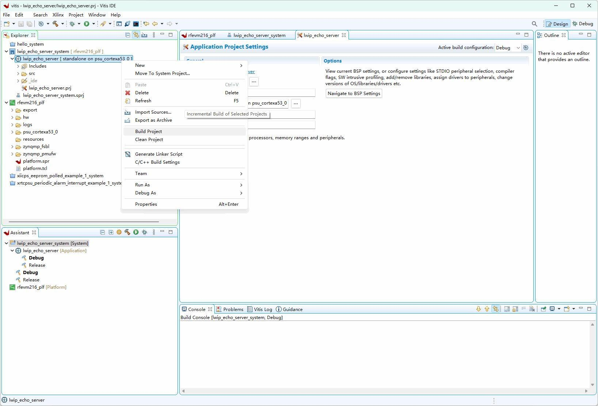

4. We open the serial port debugging terminal. After downloading the program, the terminal will display the program’s output information.
5. Open the cmd window and ping the board’s IP

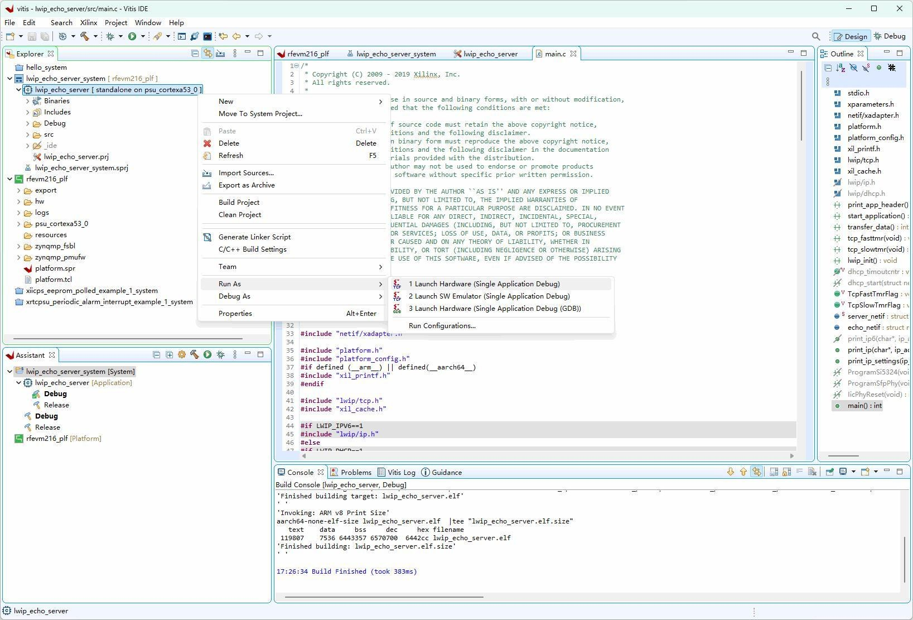

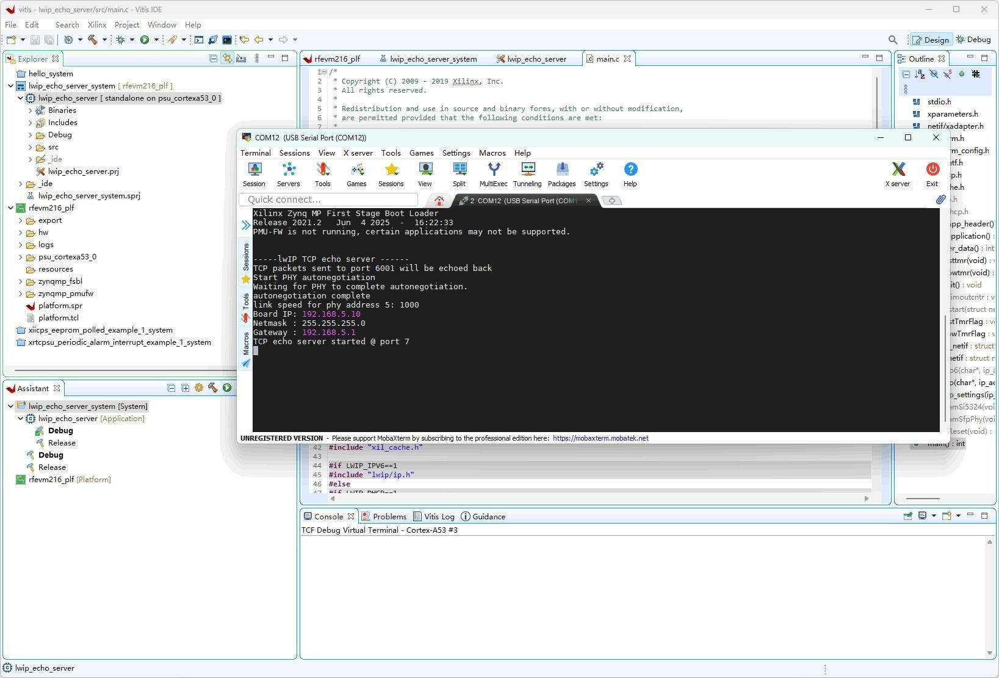

## 4.5.4 Reference Documents

https://xilinx-wiki.atlassian.net/wiki/spaces/A/pages/18842366/Standalone+LWIP+library
