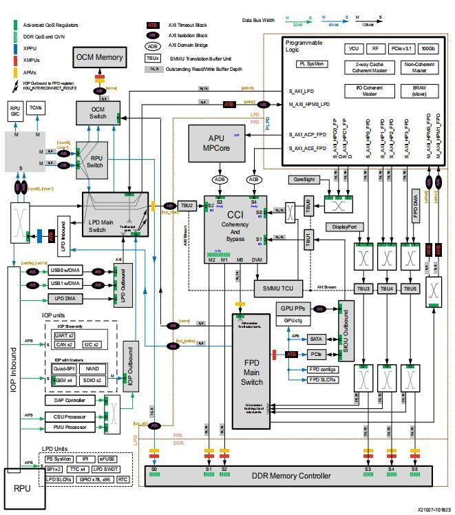

# 5. PS-PL Interconnect

[Switch to 中文](../../../zh/fpga-tutorial/05-ps-pl-interconnect/index.md)

## Experiments

- [5.1 Using EMIO on the PS side](01-emio.md)
- [5.2 Usage of AXI GPIO on the PL Side](02-axi-gpio.md)
- [5.3 PS-side Reading and Writing PL Registers](03-pl-register-access.md)
- [5.4 AXI-DMA Loopback Test](04-axi-dma-loopback.md)

## Chapter Overview

This chapter mainly introduces the interconnection between PS and PL. Before starting, a brief introduction to the data paths between PS and PL is provided. For details, please refer to the "ug1085 Zynq UltraScale+ Device Technical Reference Manual."
The data paths between PS and PL are mainly through the general AXI Memory interface. As a master device, PS has interfaces with 128-bit width HPM0/HPM1 and 64-bit width LPD_PL; as a master device, PL has interfaces ACP/ACE/HPC0/HPC1/HP0/HP1/HP2/HP3. All AXI Memory interfaces

The bit width can support up to 128-bit.
Interface Name Abbreviation
FIFO
Interface
Master
S_AXI_HP{0:3}_FPD HP{0:3} AFI_{2:5} PL
S_AXI_LPD PL_LPD AFI_6 PL
S_AXI_ACE_FPD ACE None PL
S_AXI_ACP_FPD ACP None PL
S_AXI_HPC{0,1}_FPD HPC{0,1} AFI_{0:1} PL
M_AXI_HPM{0,1}_FPD HPM{0,1} None PS
M_AXI_HPM0_LPD LPD_PL None PS
Excerpt from "ug1085"
