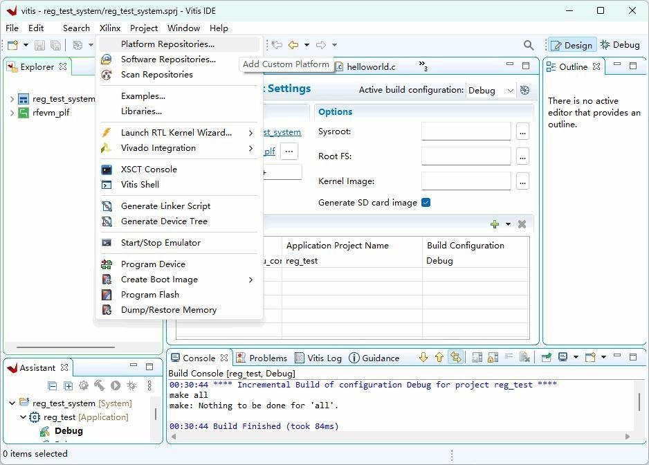
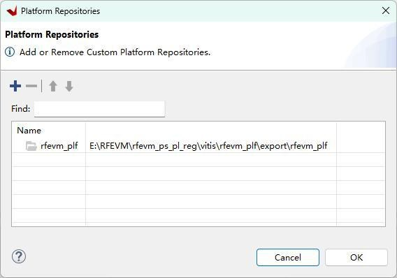

# 6. FAQs

[Switch to 中文](../../zh/fpga-tutorial/06-faqs.md)

Frequently Asked Questions

1. The provided example fails to log in to Vitis, compile/download?

After changing the example path, the platform path in Vitis software needs to be re-specified according to the current actual path:
Xilinx->Platform Repositories...
Here, just add the current path.

Or delete the platform and create a new platform; using the same name as before is also fine.

