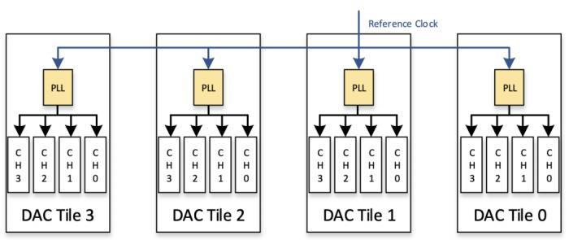
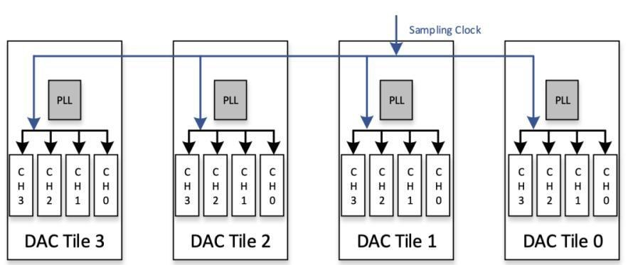
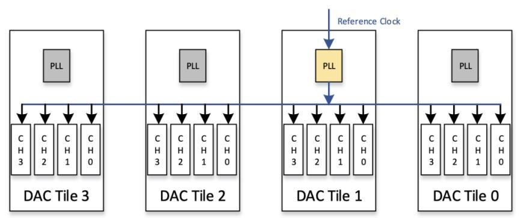
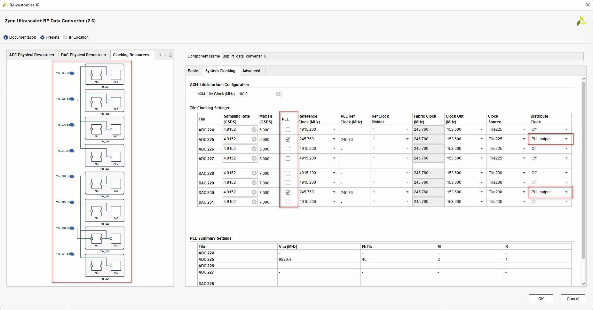
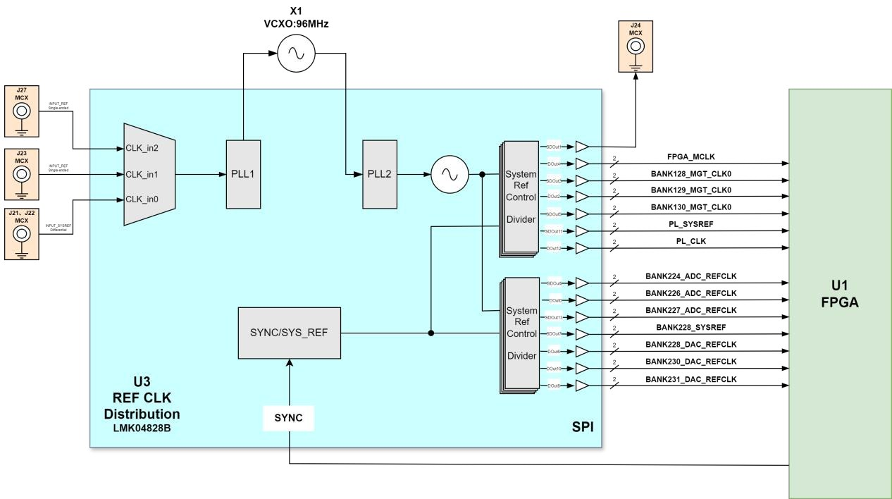

# 2.1 Clock Architecture

[Switch to 中文](../../zh/rf-development-guide/02-clock-architecture.md)

## 2.1 Introduction to Hardware Architecture

### 2.1.1 Clock Forwarding Features of RFSoC Devices

RFSoC integrates data converters on the chip. The third-generation RFSoC series devices all include 4 ADC Tiles and 4 DAC Tiles. Each ADC and DAC Tile may contain 1 (ZU43DR), 2 (ZU47DR/48DR), or 4 (ZU49DR) channels, depending on the chip model.
The RFEVM216 development board uses the ZU49DR device, where each ADC Tile contains 4 ADC channels and each DAC Tile contains 4 DAC channels.
Each Tile can be configured independently and operate at different sampling clock frequencies. The sampling clock can come from an external high-frequency clock input, from the clock multiplied by the internal PLL of each Tile, or from the reference clock distributed from other Tiles.
Compared with previous generations, third-generation RFSoC devices introduce clock forwarding features, eliminating the need to provide an independent sampling clock for each Tile, saving pin resources and reducing the complexity of peripheral circuits.
There are two types of clock forwarding: reference clock forwarding and sampling clock forwarding.
Reference clock forwarding refers to the external clock chip providing a low-noise, low-frequency clock to a dedicated clock pin of an ADC/DAC Tile. This clock pin then forwards the clock between Tiles, and the required sampling clock is generated by multiplying this clock through the PLL inside each Tile.
Sampling clock forwarding has two paths: one is where the external clock chip directly provides a low-noise, high-frequency sampling clock to a dedicated clock pin of an ADC/DAC Tile. This sampling clock is then distributed between Tiles without passing through the internal PLL, and it is provided directly to the ADC/DAC channels as the sampling clock.

The clock chip provides a low-noise, low-frequency clock to a dedicated clock pin of an ADC/DAC Tile. This clock is multiplied to the sampling frequency within the Tile through a PLL and then distributed between Tiles.
The above is only a simplified explanation of the clock distribution method. There are some usage limitations and recommendations, and users are advised to refer to PG269 Chapter 4 Clock-on-chip Clock Distribution for reading.
Users can also open Vivado, select the device model, and configure it in the RF Data Converter IP according to the schematic and target design.
The figure below shows the clock structure configuration of the RFEVM216 development board:

### 2.1.2 RFEVM216 Development Board Clock Structure

Here, we only introduce the clock section of the RFEVM216 development board related to the RF data converter. These clocks are all provided by the LMK04828 clock chip on the RFSOM SoM board.
LMK04828 is a dual-loop jitter cleaner and clock generator. The reference clock input of the first loop can be an external reference clock; the reference input of the second loop is the 96MHz VCXO on the board. Among them, DAC_REFCLK and ADC_REFCLK serve as low-frequency reference clock inputs for RF-ADC/RF-DAC; PL_CLK, PL_SYSREF, and DAC_SYSREF can all be used for MTS (Multi-Tile Synchronization) applications.
The chip model on the RFEVM216 development board is ZU49DR, which has 4 ADC Tiles and 4 DAC

