# 2. RFSOM216 SoM Board

[Switch to 中文](../../zh/user-guide/02-som-board.md)

> This chapter is translated from the Chinese source PDF. Figures and UI screenshots retain their original labels so that they match the hardware and software.  
> Source PDF: `RFEVM216_UG.pdf`  
> Source pages: 7-19

## Source PDF page 7

- Button  
A reset button.    

2 RFSOM216 Core Board    

2.1 Introduction    
The Zynq chip on the RFSOM216 SoM board is based on XILINX's Zynq™ UltraScale+™ RFSoC Gen3 series ZU49DR-2FSVF1760I.    
This SoM board uses 10 Micron DDR4 chips MT40A512M16, with 5 DDR4 chips mounted on the PS side to form a 64-bit data bus with ECC functionality. The PL side is equipped with 5 DDR4 chips to form a 72-bit data bus. Each DDR4 chip has a capacity of 1GB. The maximum operating speed of the DDR4 SDRAM can reach 1333MHz (data rate 2666Mbps). In addition, the SoM board also integrates a 1Gbit QSPI flash for boot configuration and system files.    

To connect with the baseboard, the SoM board has 3 800-pin board-to-board connectors that extend the PS side with USB 3.0 interface, Gigabit Ethernet interface, SD card interface, M.2 interface, DP interface, and the remaining MIO interfaces; and the PL side with 2 QSFP28 interfaces, FMC+ expansion interface, and other expansion IO.

### Figures

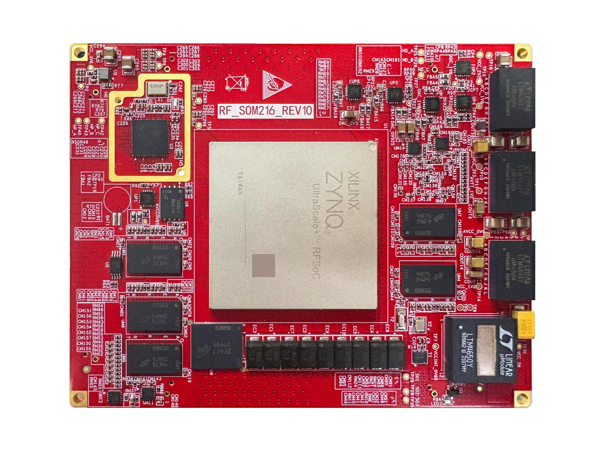

---

## Source PDF page 8

Figure 2 RFSOM216 Core Board Front    
Figure 3 RFSOM216 Core Board Back    

2.2 Zynq Chip    
The RFSOM216 SoM board uses Xilinx's Zynq™ UltraScale+™ RFSoC Gen3 series chip, model ZU49DR-2FSVF1760I. The programmable logic portion's FPGA resources can provide high-throughput digital signal processing (DSP) and IP cores, such as digital up/down conversion (DUC/DDC) cores. FPGA acceleration is easier to implement through the software-defined radio development framework application programming interface and FPGA infrastructure. This helps you get up and running quickly so that you can focus on value-added IP. FPGA systems for commonly used functions such as Fast Fourier Transform (FFT) and Finite Impulse Response (FIR) filters are a good starting point. Then, you can use your preferred hardware description language (HDL) to add your own IP blocks to the modular architecture.    

In addition to the system's FPGA architecture portion, the Xilinx UltraScale+ RFSoC is also equipped with four onboard Application Processing Units (APUs) and two Real-Time Processing Units (RPUs), suitable for applications that require an onboard embedded operating system for independent operation.

### Figures

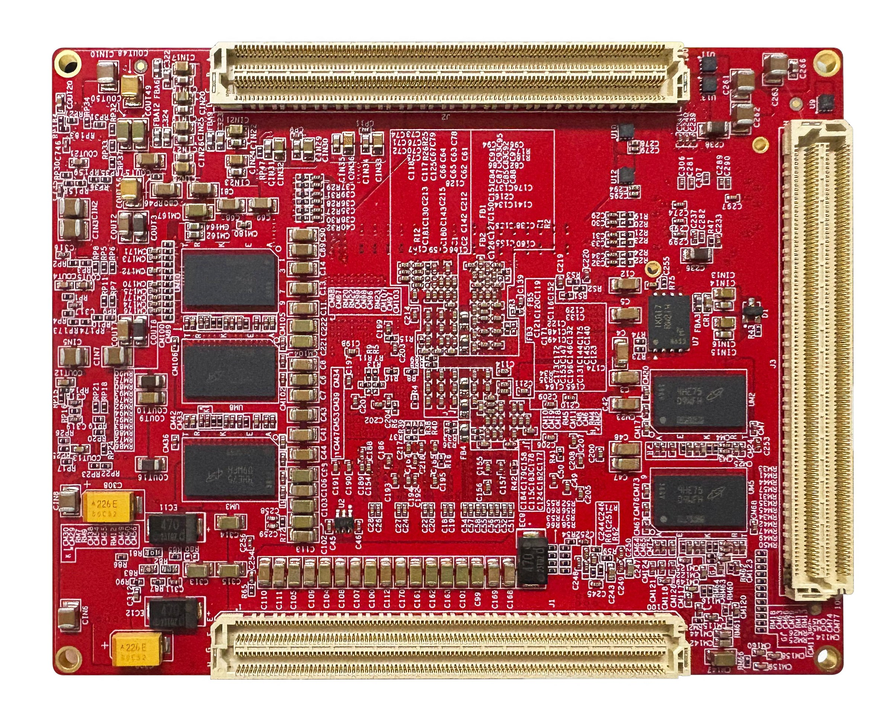

---

## Source PDF page 9

Figure 4 RFSOM Hardware System Block Diagram  

2.3 DDR4 SDRAM  
The RFSOM216 SoM board is equipped with ten 1GB DDR4 chips from Micron (Micron), model number MT40A512M16LY-075E. Among them, five DDR4 chips are mounted on the PS side, forming a 64-bit data bus width with ECC functionality. Five DDR4 chips are mounted on the PL side, forming a 72-bit data bus width. The DDR4 SDRAM on the PS side can operate at a maximum speed of 1200MHz (data rate 2400Mbps), and the 5 DDR4 memory system is directly connected to the PS's BANK504 memory interface. The DDR SDRAM on the PL side can operate at a maximum speed of 1333MHz (data rate 2666Mbps), and the 5 DDR4 chips are connected to the FPGA interfaces BANK67, 68, and 69. The specific configurations of the DDR4 SDRAM on the PS and PL sides are shown in the table below.  

Table 1 DDR4 SDRAM Configuration  
Position Number | Chip Model | Capacity | Manufacturer  
PS | UM1, UM2, UM5, UM6, UM9 | MT40A512M16LY-075E | 512x16bit | Micron  
PL | UM3, UM4, UM7, UM8, UM10 | MT40A512M16LY-075E | 512x16bit | Micron  

The hardware connection method of the DDR4 on the PS side is shown in the figure below:

### Figures

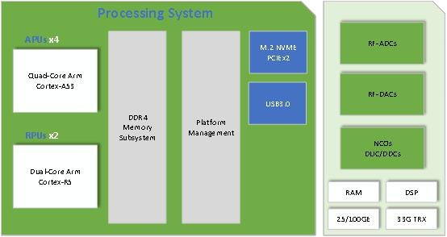

---

## Source PDF page 10

10 / 42  
Figure 5 PS-side DDR4 SDRAM connection diagram  
The hardware connection method of the PL-side DDR4 SDRAM is shown in the figure below:  
Figure 6 PL-side DDR4 SDRAM connection diagram

### Figures

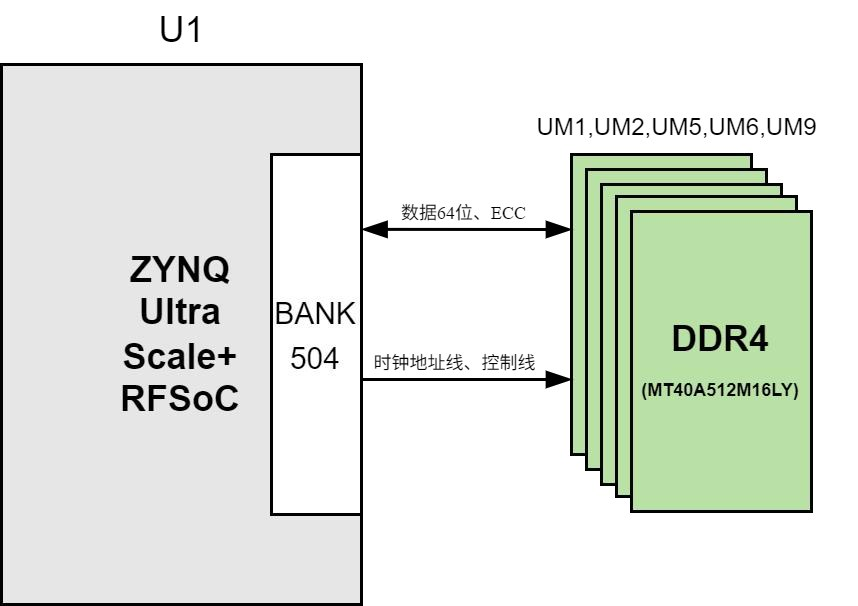

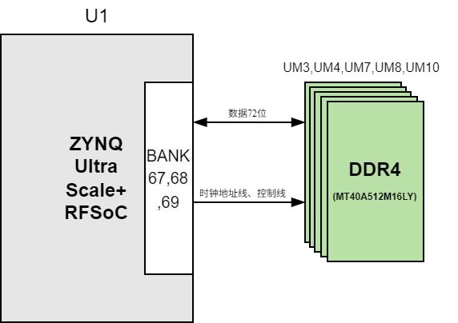

---

## Source PDF page 11

11 / 42    

2.4 QSPI flash    
The RFSOM216 SoM board is equipped with two 512Mbit QUAD SPI flash chips forming an 8-bit bandwidth data bus. The flash model is MT25QU512ABBIEW9-0SIT, which operates at a 1.8V CMOS voltage standard. Due to the non-volatile nature of QSPI flash, it can be used as the system startup device to store system boot images. These images mainly include the FPGA bit file, ARM application code, and user data files. The specific model and related features of QSPI flash are listed in the table below.    

Table 2 QSPI flash Model and Parameters    
Location Chip Model Capacity Manufacturer    
PS U6,U7 MT25QU512ABBIEW9-0SIT 512Mbit Micron    

QSPI flash is connected to the MIO of BANK500 in the PS portion of the Zynq chip. In system design, the MIO functions of these PS pins need to be configured as the QSPI flash interface.    

Figure 7 QSPI flash Connection Diagram    

Table 3 Configuration of Chip Pin Assignment    
Signal Name Pin Name Pin Number    
SPIL_SCLK PS_MIO0 BB27    
SPIL_MO1 PS_MIO1 BA27

### Figures

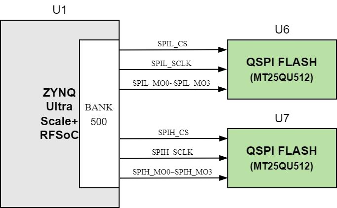

---

## Source PDF page 12

12 / 42  
SPIL_MO2 PS_MIO2 BB26  
SPIL_MO3 PS_MIO3 BB28  
SPIL_MO0 PS_MIO4 BA28  
SPIL_CS PS_MIO5 BA29  
SPIH_CS PS_MIO7 AY27  
SPIH_MO0 PS_MIO8 AW27  
SPIH_MO1 PS_MIO9 AW26  
SPIH_MO2 PS_MIO10 AV26  
SPIH_MO3 PS_MIO11 AW28  
SPIH_SCLK PS_MIO12 AV28  
2.5 eMMC Flash  
The RFSOM216 SoM board is equipped with one 8GB eMMC flash chip, model MTFC8GLVEA-1MWT, with a voltage standard supporting 1.8V. The data width of the connection between eMMC flash and Zynq is 8bit. Due to the large capacity and non-volatility of eMMC flash, in Zynq system usage, it can serve as a large-capacity storage device for the system, such as storing ARM applications, system files, and other user data files. The specific model and related parameters of the eMMC flash are shown in the table below.  
Position Pin Chip Model Capacity Manufacturer  
PS U4 MTFC8GLVEA-1MWT 8GB Micron  
The eMMC flash is connected to the MIO of BANK500 in the PS section of Zynq. In system design, the MIO functions of these PS pins need to be configured as the EMMC interface. The connection method of the eMMC Flash in the schematic is shown as follows.

---

## Source PDF page 13

13 / 42  
Signal Name Pin Name Pin Number  
EMMC_RST PS_MIO23 AM27  
EMMC_CLK PS_MIO22 AL27  
EMMC_CMD PS_MIO21 AN28  
EMMC_IO0 PS_MIO13 AU26  
EMMC_IO1 PS_MIO14 AU27  
EMMC_IO2 PS_MIO15 AT27  
EMMC_IO3 PS_MIO16 AU28  
EMMC_IO4 PS_MIO17 AT28  
EMMC_IO5 PS_MIO18 AP28  
EMMC_IO6 PS_MIO19 AR27  
EMMC_IO7 PS_MIO20 AP27  
2.6 EEPROM  
The RFSOM216 core module has an onboard EEPROM, model AT24CM01, with a capacity of 1 Mbit, connected to the PS side via an I2C bus for communication.

### Figures

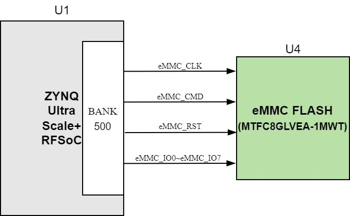

---

## Source PDF page 14

14 / 42  
Figure 8 EEPROM Hardware Schematic  
Table 4 EEPROM Pin Assignment  
Signal Name  Pin Name  Pin Number  Remarks  
IIC_SCL     PS_MIO24  AL28        I2C Clock Signal  
IIC_SDA     PS_MIO25  AM28        I2C Data Signal  

2.7 Clock Configuration  
The core module provides dual crystal oscillators. The system clock by default uses a 33.3333 MHz active crystal oscillator, packaged in 3.2x2.5mm. A 32.768 KHz crystal drives the internal RTC circuit of the RFSOC. The schematic of the clock circuit design is shown in the figure below:

### Figures

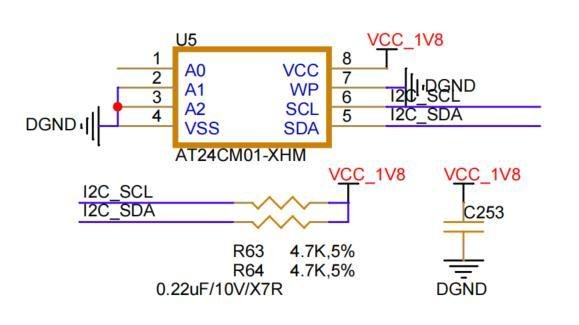

---

## Source PDF page 15

15 / 42  
Figure 9 Crystal Oscillator Schematic  
The core module system uses the LMK04828 clock chip to distribute the clocks required by the ADC and DAC modules. The main crystal oscillator uses a 96MHz high-stability VCXO. It supports single-ended input for an external reference clock and differential input for SYSREF, enabling multiple modules to be paralleled to form larger-scale phase-aligned RF channels.  
Figure 10 Clock Distribution Connection Diagram  
2.8 RF-ADC Interface  
The FPGA chip used in the RFSOM core module is the Zynq™ UltraScale+™ RFSoC Gen3 series.

### Figures

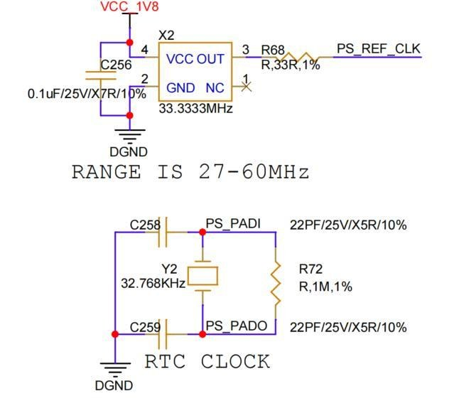

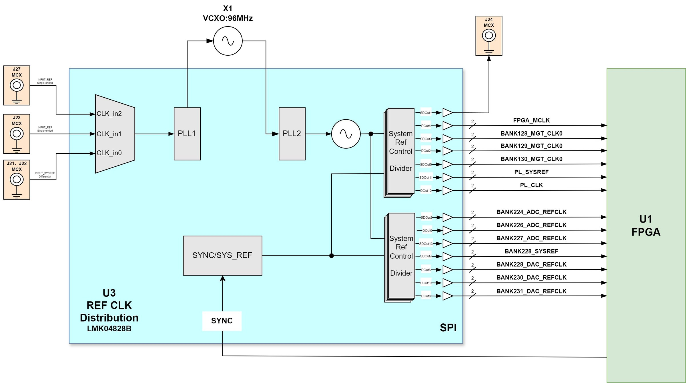

---

## Source PDF page 16

16 / 42  
The industry's only single-chip adaptive radio platform, the chip integrates a 14-bit RF-ADC with a maximum sampling rate of up to 2.5 GSPS, and the VCM signal is also routed to the connector.  
Figure 11 RF-ADC Interface Diagram  
2.9 RF-DAC Interface  
The FPGA chip used in the RFSOM core module is the Zynq™ UltraScale+™ RFSoC Gen3, the industry's only single-chip adaptive radio platform. The chip integrates a 14-bit RF-DAC with a maximum sampling rate of up to 9.85 GSPS.  
Figure 12 RF-DAC Interface Diagram  
2.10 High-Speed Board-to-Board Connectors  
The SoM board expands to a total of 3 high-speed expansion ports, using three 400-pin board-to-board connectors (J1,

### Figures

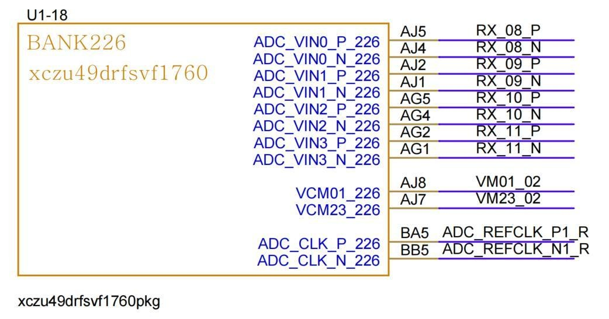

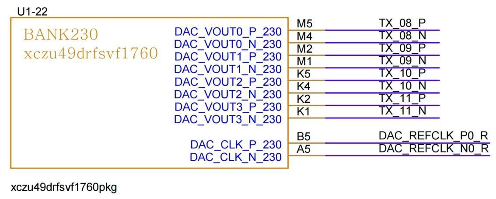

---

## Source PDF page 17

17 / 42 J2, J3) are connected to the baseboard using Samtec's ASP_230332-01 connectors, 0.635mm pitch, 5mm mating height, with each channel supporting up to 32Gbps.  

2.11 Power Supply  
The RFSOM216 SoM board uses a 12V DC power supply and receives power through the connector from the baseboard. The 12V system power is converted by a buck-type voltage regulator to drive the FPGA and other circuits on the board. The power supply for the board's ADC and DAC is provided by a linear low-dropout (LDO) regulator, offering a good power supply rejection ratio (PSRR).  

The voltage levels for the core module's extended IO BANK interface are as follows:  

BANK Voltage (V) Notes  
BANK64 Provided by baseboard, 1.8V HP BANK  
BANK65 Provided by baseboard, 1.8V HP BANK  
BANK66 Provided by baseboard, 1.8V HP BANK  
BANK67 1.2V fixed DDR4 signal  
BANK68 1.2V fixed DDR4 signal  
BANK69 1.2V fixed DDR4 signal  
BANK84 1.8V fixed LMK04828 configuration signal and output  
BANK87 Provided by baseboard, 3.3V HD BANK  
BANK88 Provided by baseboard, 3.3V HD BANK  
BANK89 Provided by baseboard, 3.3V HD BANK  
BANK128 MGTY FMC+ signal  
BANK129 MGTY FMC+ signal  
BANK130 MGTY QSFP28 signal  
BANK131 MGTY QSFP28 signal  
BANK500 1.8V fixed QSPI and EMMC signal

### Figures

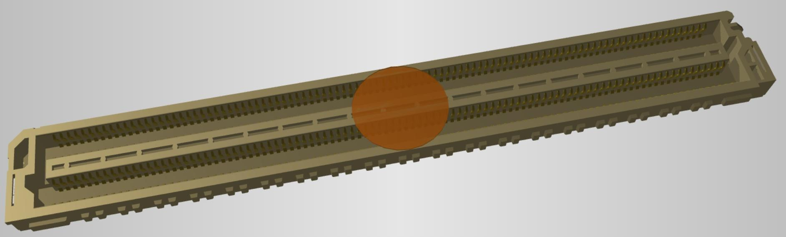

---

## Source PDF page 18

18 / 42  
BANK501 MIO BANK support of 1.8V, 2.5V, and 3.3V at ±5% is provided from the baseboard  
BANK502 MIO BANK support of 1.8V, 2.5V, and 3.3V at ±5% is provided from the baseboard  
BANK503 MIO BANK support of 1.8V, 2.5V, and 3.3V at ±5% is provided from the baseboard  
BANK505 All PS_MGTR high-speed signal pins and clock signals are routed out to the connector  
The power design block diagram of the RFSOM SoM board is shown below:  
Figure 13 Power Design Block Diagram of the RFSOM Core Board

### Figures

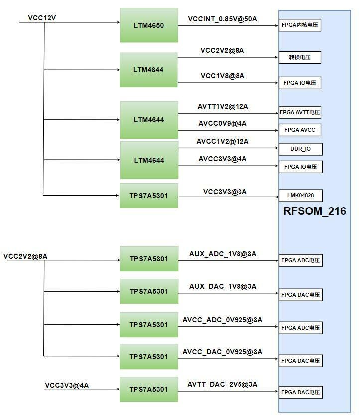

---

## Source PDF page 19

19 / 42  
2.12 Structure Diagram  
Figure 14 Front View of RFSOM216 Core Module

### Figures

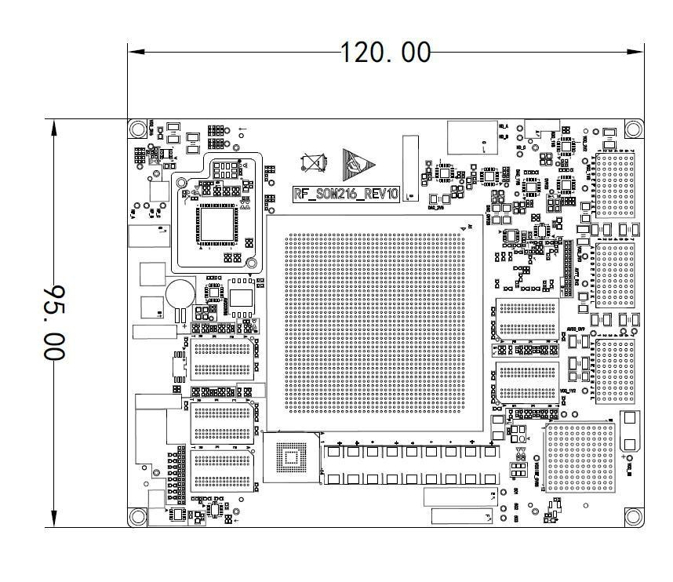
