# 4.8 基于 PS 的 USB slave 功能测试

[Switch to English](../../../en/fpga-tutorial/04-ps-peripherals/08-usb-slave.md)

[返回章节总览](index.md)

ZYNQ 的 USB 接口可以同时当作 USB HOST 和 USB DEVICE(SLAVE)，USB
功能大多数情况下都是在 linux 下使用的，这里我们在裸机下去测试 USB 功能。
我们使用官方提供的演示 demo，去把 usb 设备模拟成 U 盘的功能进行测试。

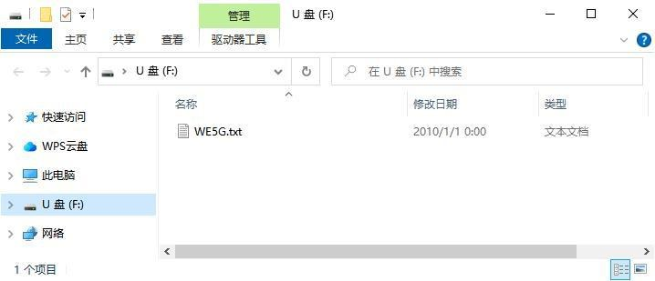

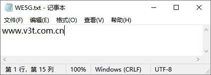

## 4.8.1 硬件设计

图 16 USB 接口原理图

## 4.8.2 软件设计

4. 登录 Vitis，切换到之前的工作目录，然后双击 platform.spr，选中 Board Support

Package，可以看到 psu_usb_xhci_0 的文档链接和导入示例。

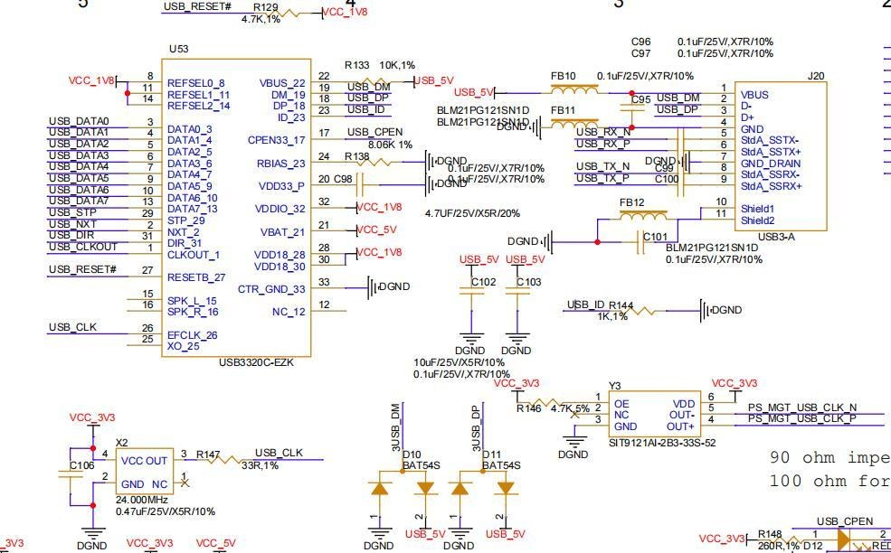

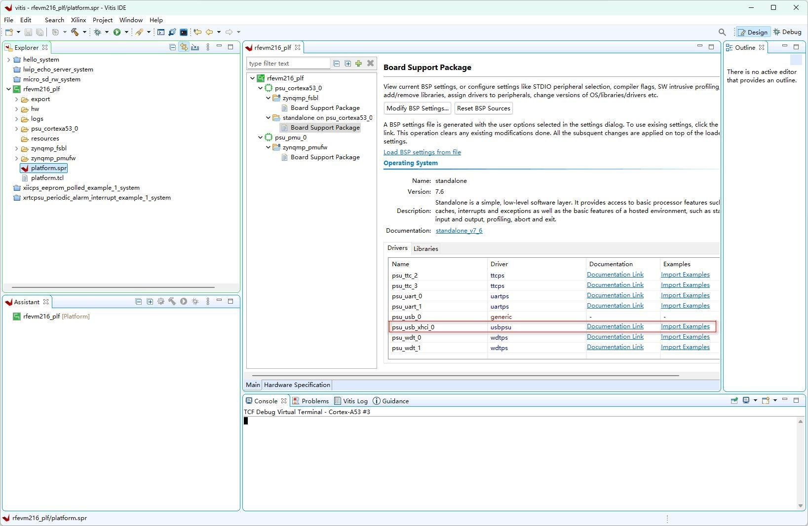

5. 点击 Import Example，然后选中 xusb_poll_example 示例，点击 OK
6. 可以看到导入的示例应用工程
7. 选中应用工程，右键点击 Build Project

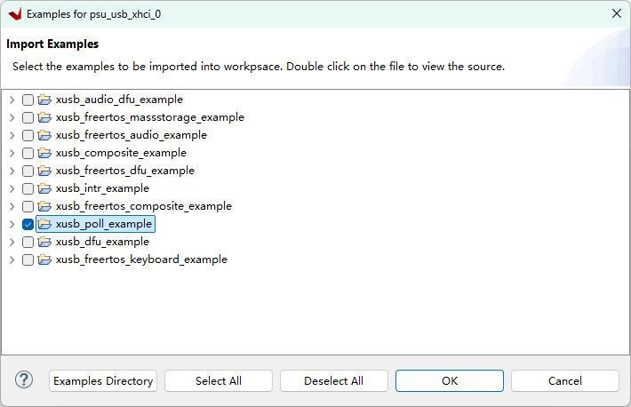

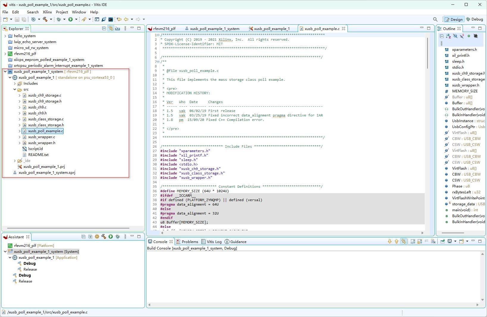

编译信息可以在 Console 窗口中看到。

## 4.8.3 下载验证

这里我们需要使用 USB 公对公的数据线一端连到 RFEVM216 的 USB 接口
上，另外一端连到 PC 端。然后给开发板上电。
右键应用工程，选择 Run As->Launch Hardware(Single Application Debug)

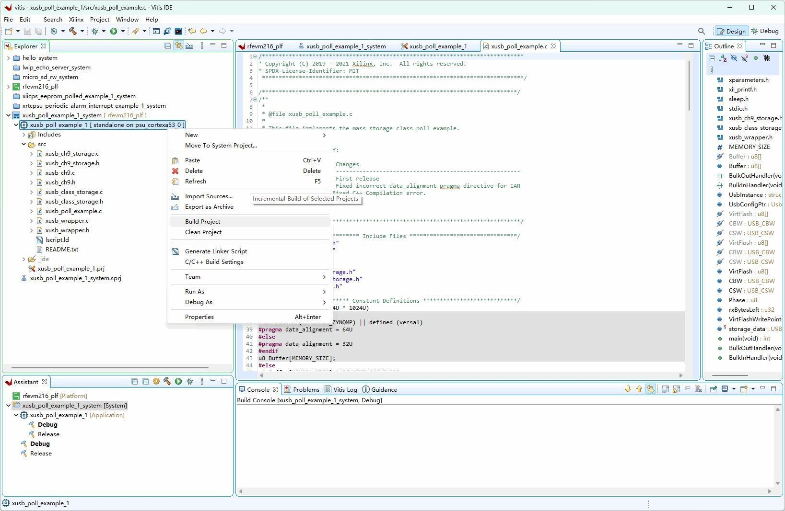

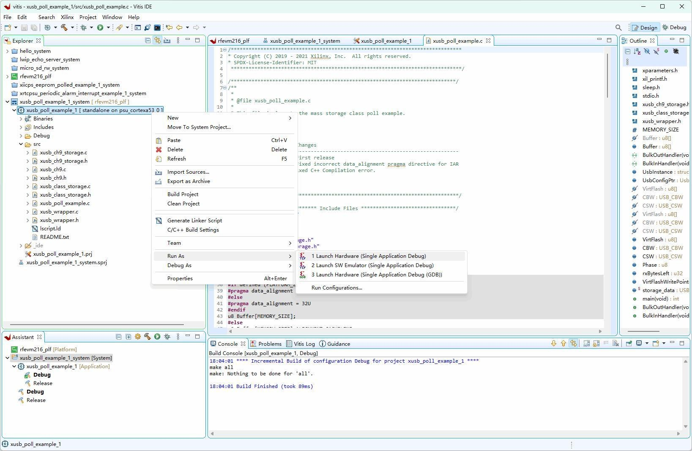

打开串口终端，下载完成后，可以查看串口输出：
PC 侧会弹出如下窗口，点击“格式化磁盘”即可
在我的电脑里面，可以看到由 DDR RAM 虚拟出来的 U 盘，可以像正常 U 盘一
样复制粘贴文件，注意这个 U 盘断电数据会丢失请不要放重要文件。
容量大小可以在程序里面去配置，请不要超过板子上的 DDR 容量大小。
我们可以使用 Xilinx WiKi 推荐的 CrystalDiskMark 工具对 U 盘进行性能测速。

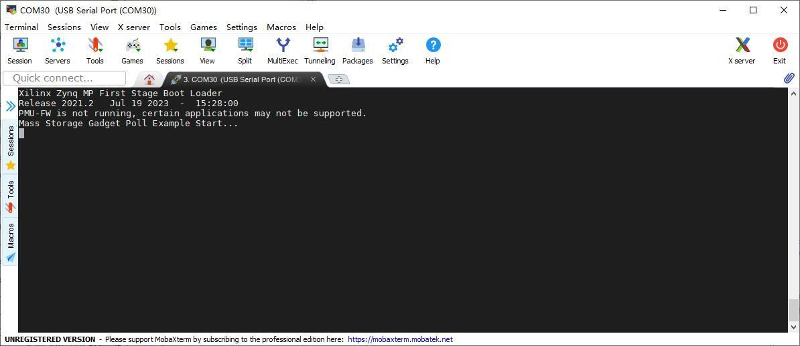

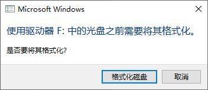

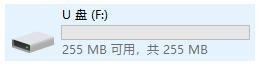

## 4.8.4 参考文档

https://xilinx-wiki.atlassian.net/wiki/spaces/A/pages/18842468/ZynqMp+USB+Stadal
one+Driver

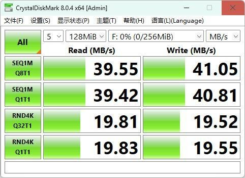
