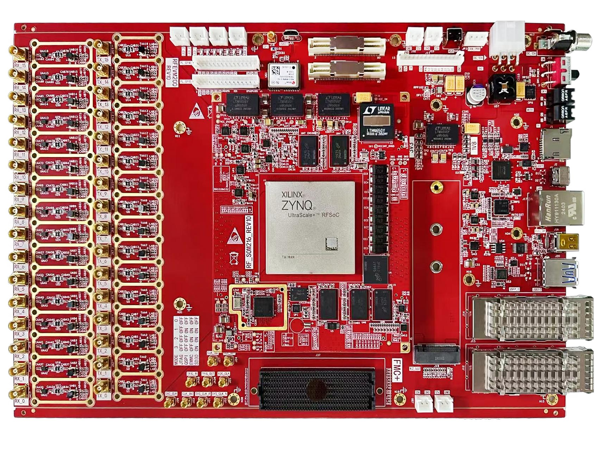

# 前置内容

[Switch to English](../../en/rf-development-guide/00-front-matter.md)

> 本章内容来自中文原始 PDF。图示和软件界面截图保留原标签，以便与硬件和软件实际界面对应。  
> Source PDF: `RFEVM216开发板射频开发指南s.pdf`  
> Source pages: 1-2

## 原 PDF 第 1 页

RFEVM216 开发平台  
RF 开发指南  
Rev. 1.0

### 图示

---

## 原 PDF 第 2 页

目录  
1 简介 .................................................................................................................... 3  
2. FPGA 最小系统搭建 ........................................................................................ 3  
2.1 硬件架构介绍 ......................................................................................... 4  
2.1.1 RFSoC 器件时钟转发特性 ..........................................................4  
2.1.2 RFEVM 开发板时钟结构 ............................................................6  
2.2 RF 数据转换器配置指南 ........................................................................7  
RF-ADC 片设置 ....................................................................................9  
RF-DAC 片配置 ..................................................................................12  
系统时钟配置 ..................................................................................... 15  
高级配置 ............................................................................................. 17  
2.3 FPGA 硬件工程介绍 ............................................................................ 18  
2.4 裸机应用程序 ....................................................................................... 23  
2.5 运行 demo 例程 .....................................................................................28  
附录 A-API 介绍 .................................................................................................36
