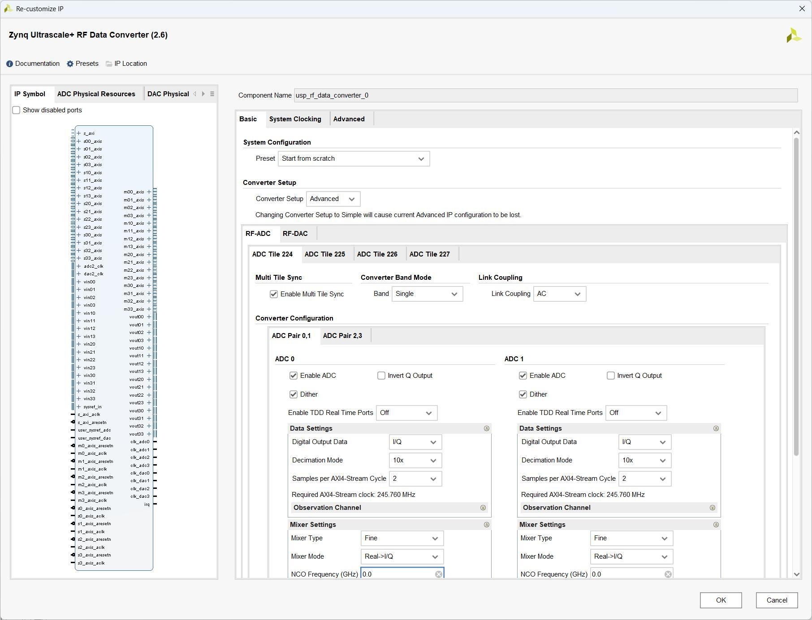
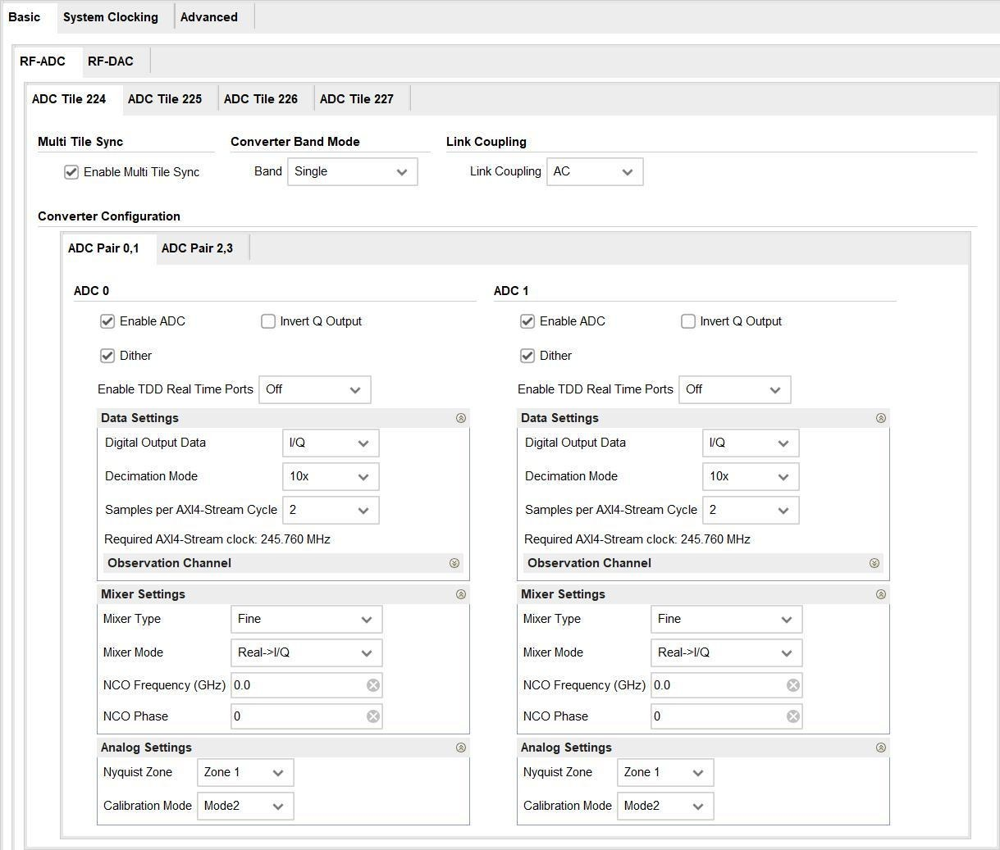
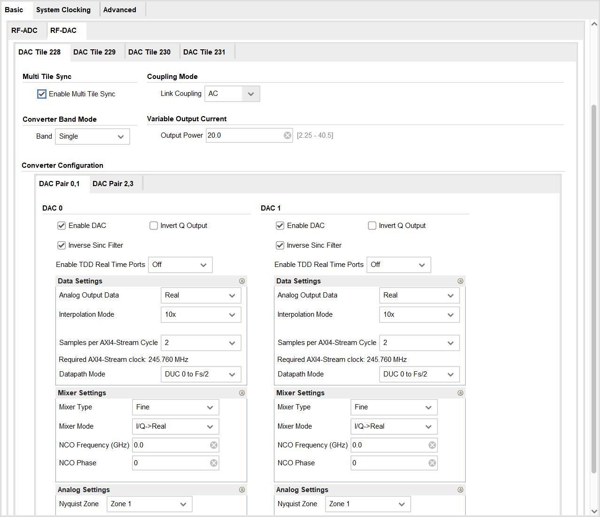
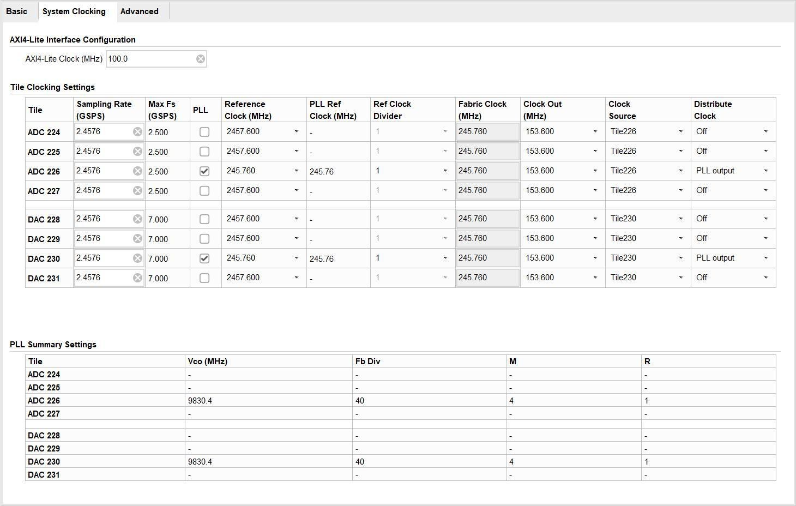
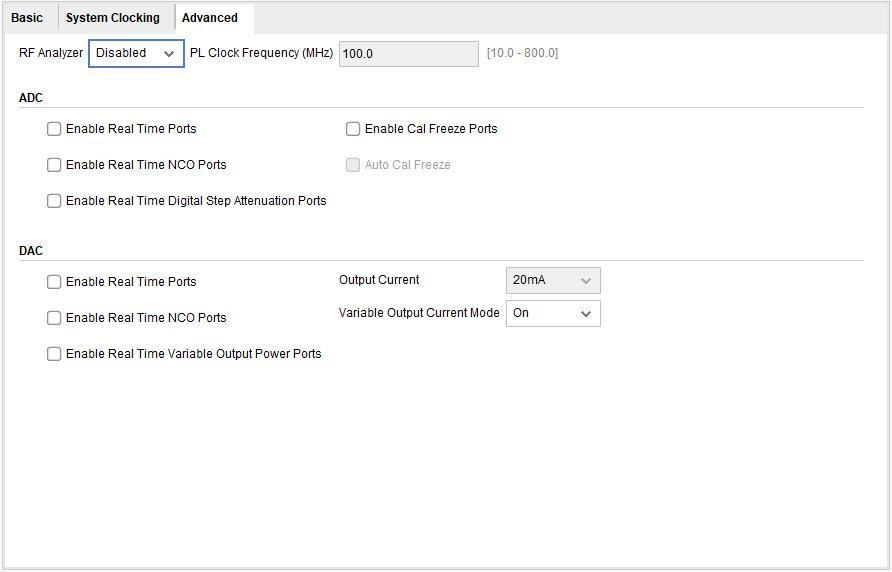

# 2.2 RF 数据转换器配置

[Switch to English](../../en/rf-development-guide/03-rfdc-configuration.md)

Tile 都有专用的时钟输入引脚，但只有三个 ADC Tile（Bank 224/226/227）和三
个 DAC Tile（Bank 228/230/231）的时钟管脚被直接引出到 LMK04828 时钟芯片
上。BANK225 和 BANK229 的时钟管脚引到底板的 MCX 接口上，可由外部提
供，如下表所示为详细连接关系：
ADC/DAC Tile 信号名时钟输出源 LMK04828
ADC Tile 224 ADC_REFCLK_N2/P2_R SDCLKOUT9
ADC Tile 225 RF_ADC_CLK_N/P
ADC Tile 226 ADC_REFCLK_N1/P1_R DCLKOUT0
ADC Tile 227 ADC_REFCLK_N3/P3_R SDCLKOUT13
DAC Tile 228 DAC_REFCLK_N1/P1_R DCLKOUT6
DAC Tile 229 RF_DAC_CLK_N/P
DAC Tile 230 DAC_REFCLK_N0/P0_R DCLKOUT10
DAC Tile 231 DAC_REFCLK_N3/P3_R DCLKOUT8

## 2.2 RF 数据转换器配置指南

RFSoC 射频数据转换器 IP 核提供了一个可配置的封装器，允许 RF-ADC 和
RF-DAC 块用于 IP 集成器设计。
具体细节可参考官方文档：
https://docs.xilinx.com/r/en-US/pg269-rf-data-converter
这里以 RFEVM216（xczu49dr）开发平台为例，去介绍 IP 的相关配置。
IP 基础配置
Basic 页面
Presets（预配置）
Vivado IDE IP 核心配置界面提供了一种保存和应用预设配置的方法。从预设菜
单，几个固定配置是可用的。
ADC:R2C Multi x2 DAC:C2R Multi x2(Beta)：RF-ADC 配置在 x2 多波段使用实
转虚的数据，RF-DAC 配置在 x2 多波段使用虚转实的数据。
DAC:C2C Multi 2x2(Beta)：在单个 RF-DAC 块上的 2x2 多频段使用虚到虚的数
据。
DAC:C2R Multi 2x2(Beta)：在单个 RF-DAC 块上的 2x2 多频段使用虚到实的数
据。
DAC:C2R Multi x4(Beta)：在单个 RF-DAC 块上的 1x4 多频段使用虚到实的数据。
Converter Setup（变频器的设置）
转换器设置菜单为设置 IP 配置提供了高级（Advanced）和简单（Simple）的选
项。

Advanced：所有片都是独立配置的。
Simple：用户可以看到单个 RF-ADC 和 RF-DAC 块的配置选项。设置好片配置
信息后，通过从给定的片列表中选择片，就可以将 RF-ADC 配置应用到设备中
的任何 RF-ADC。类似地，RF-DAC 配置可以应用于任何 RF-DAC 片。
可以在不丢失配置信息的情况下从简单设置更改为高级设置。但是，从高级到简
单是不可能的。只支持向下兼容。
RF-ADC 片设置
这些参数对片中每个 RF-ADC 都是通用的。
Link Coupling（链路耦合）：这决定了 RF-ADC 的输入信号是交流耦合还是直
流耦合。典型的应用程序使用交流耦合，单对于某些应用程序（例如 Zero IF），
也支持直流耦合。当选择直流耦合模式时，外部驱动电路的共模电压需要使用外
部驱动的 VCM 引脚与 RF-ADC 内部的共模电压对齐。VCM 引脚只能用于直流

耦合模式，如果选择交流耦合模式，则可以保持浮动。（RFEVM216 目前底板设
计为交流耦合模式）
Converter Band Mode（转换器频带模式）：每个 RF-ADC 可以独立工作（单频
带模式），也可以与其它转换器一起工作（多频带模式），以下模式可用于 RF-ADC。
Enable ADC（启用 ADC）：选择是否启用所选片内的所选转换器。
Invert Q Output（Q 逆变输出）：只有选择 I/Q 输出数据且开启微调混频器时才
能设置。当设置时，混合器的求积输出为负。这允许生成-Q 数据。
Dither（抖动）：选择所选片是否启用了抖动。抖动应启用，除非采样率低于 0.75
倍的 RF-ADC 的最大采样率。
Enable TDD Real Time Ports（Gen 3）启用了 TDD 实时端口：启用后，tdd_mode
端口将添加到 IP。这可以通过关闭 RF-ADC 的部分来实现节能。
Digital Output Data（数字输出数据）：设置片内所选转换器的数据类型。该参
数仅在启用转换器时可配置。有效值为 Real/IQ。当转换器 0 被设置为 I/Q 时，
转换器 1 也必须被启用，当转换器 2 被设置为 I/Q 时，转换器 3 也必须被启用，
否则配置无效。
Decimation Mode（抽取模式）：设置所选片内所选转换器的抽取值。该参数仅
在转换器启用时可配置。从下拉菜单中选择值 1x、2x、3x、4x、5x、6x、8x、
10x、12x、16x、20x、24x、40x。当转换器未启用时，该值为关闭。
Samples per AXI4-Stream Word（每 AXI4-Stream 的采样字数）：设置每个周
期的字数。当特定转换器已启用时，此参数是可配置的。有效值介于 1 和 12 之
间 ， 可以使用下拉列表进行选择 。 取值范围取决于所选的采样率 ， 以将
AXI4-Stream 时钟保持在规范范围内。所需的 AXI4-Stream 时钟是 IP 核的输入，
并显示基于所选总线宽度的值。
Observation Channel（观测通道）：启用并设置观测通道。
Mixer Type（混频器类型）：设置要使用的混频器类型（coarse、fine）。可选择
的选项取决于转换器数字输出数据字段的选择。
Mixer Mode（混频器模式）：设置所选转换器的混合器模式。该参数仅在启用
转换器时可配置。混频器模式的选择取决于混频器类型和所选数字输出数据的格
式。当实数据输出时，混频器被绕过。当 I/Q 数据输出混频器可以设置为 read
的 I/Q 或 I/Q 到 I/Q。
Coarse Mixer Frequency（粗混频器频率）：设置粗混频器的频率。混频器类型
选择为粗调时，此参数可配置。有效选项为 Fs/2、Fs/4、和-Fs/4。
Fine Mixer Frequency（细混频器频率）：设置细混频器的频率。此参数仅在选
择 fine 作为混合器类型时有效。有效频率范围为-10GHz~10GHz。
Fine Mixer Phase（细混频器相位）：设置细混频器的相位。此参数仅在选择 fine
作为混合器类型时有效。有效范围为-180 到 180。
Nyquist Zone（奈奎斯特区）：选择偶数和奇数奈奎斯特区操作。
Calibration Mode（校准模式）：根据输入信号的特性选择不同的校准优化方案。
自动模式（第三代）适用于所有输入频率。模式 1 是最佳输入频率 Fsamp/2（Nyquist）
±10%。模式 2 是输入频率输出的最佳范围。
RF-DAC 片配置
这些参数对一个 tile 中的每个 RF-DAC 都是通用的。
Multi Tile Sync（多片同步）：启用后，块包含在多片同步组中。RF-DAC Tile0
必须启用并与被配置为启用此选项的 tile 的转换器 0 一起出现在组中。
Variable Output Current（Gen3）（可变输出电流（第三代））：当可变输出电
流模式启用时，输出电流按照 DC 和 AC Switching 中的规定设置。DAC_AVTT
必须设置为 3.0V。
Link Coupling（链路耦合）：这决定了 RF-DAC 的输出信号是交流耦合还是直
流耦合。在直流耦合模式下。共模电压是固定的。在此模式下，VOP 范围会减
小。
RF-DAC 转换器配置

Common
Enable DAC（启用 DAC）：选择是否启用所选片内的所选转换器。取值为 TRUE
和 FALSE。
Invert Q Output（Q 逆变输出）：当使能时，转换器的 Q 输出被反转。仅当勾
选“I/Q 输出数据”时可设置。后续的模拟混频器必须实现减法。1 x cos(f) - Q x
sin(f)，因此提供了一个-Q 信号（负正交）的选项，以便外部混频器可以执行加
法，
I x cos(f) + (-Q)sin(f)。
Inverse Sinc Filter（Sinc 逆变滤波器）：选择是否启用 Sinc 逆变滤波器。该参
数仅在启用转换器时可配置。取值为 TRUE 和 FALSE。这适用于两个 Nyquist
区域，基于模拟设置→Nyquist 区域选择。
Enable TDD Real Time Ports（Gen3）启用 TDD 实时端口：启用后，tdd_mode
端口将添加到 IP。这可以通过关闭 RF-DAC 的部分来实现功能。
Digital Output Data（数字输出数据）：设置所选片内所选转换器的数据类型。
该参数仅在启用转换器时可配置。有效值为 Real 和 I/Q。当转换器 0 被设置为 I/Q
时，转换器 1 也必须被启用；当转换器 2 被设置为 I/Q 时，转换器 3 也必须被启
用，否则配置无效。
Decimation Mode（抽取模式）：设置所选片内所选转换器的抽取值。该参数仅
在转换器启用时可配置。从下拉菜单中选择值 1x、2x、3x、4x、5x、6x、8x、
10x、12x、16x、20x、24x、40x。当转换器未启用时，该值为关闭。
Samples per AXI4-Stream Word（每 AXI4-Stream 的采样字数）：设置每个周
期的字数。当特定转换器已启用时，此参数是可配置的。有效值介于 1 和 12 之
间 ， 可以使用下拉列表进行选择 。 取值范围取决于所选的采样率 ， 以将
AXI4-Stream 时钟保持在规范范围内。所需的 AXI4-Stream 时钟是 IP 核的输入，
并显示基于所选总线宽度的值。
Datapath Mode（Gen3）数据路径模式：选择 RF-DAC 数据路径模式。以下选
项是可用的。这些模式适用于数字数据路径，可以使用模拟设置→奈奎斯特区域
选择来自第一或第二奈奎斯特区域输出该数据。
DUC 0 to Fs/2：全奈奎斯特特 DUC 模式。
DUC 0 to Fs/4：使用低通 IMR 滤波器的半奈奎斯特 DUC 模式。
DUC Fs/4 to Fs/2：使用高通 IMR 滤波器的半奈奎斯特 DUC 模式。
No DUC 0 to Fs/2：DU 旁路模式。
Mixer Settings
Mixer Type（混频器类型）：设置要使用的混频器类型。有效的选项有 bypassed、
coarse and fine。可选择的选项取决与转换器数字输出数据字段的选择。
Mixer Mode（混频器模式）：设置所选转换器的混合器模式。该参数仅在启用
转换器时可配置。混频器模式的选择取决于混频器类型和所选数字输出数据的格
式。当真实数据输出时，混频器被绕过。当 I/Q 数据输出混频器可以设置为 real
的 I/Q 或 I/Q 到 I/Q。
Coarse Mixer Frequency（粗混频器频率）：设置粗混频器的频率。混频器类型
选择为粗调时，此参数可配置。有效选项为 Fs/2\、Fs/4 和-Fs/4。
Fine Mixer Frequency（细混频器频率）：设置细混频器的频率。此参数仅在选
择 fine 作为混频器类型时有效。有效范围额外：-10GHz~10GHz。
Fine Mixer Phase（细混频器相位）：设置细混频器的相位。此参数仅在选择 fine
作为混合器类型时有效。有效范围时-180 到 180。
Analog Settings
Nyquist Zone（奈奎斯特区）：选择偶数和奇数奈奎斯特区操作。
Decode Mode（解码模式）：RF-DAC 解码器可以优化为低信噪比或高线性度。

### 系统时钟配置

AXI4-Lite 接口配置
AXI Clock Frequency（MHz）：核心需要关于 AXI4-Lite 时钟输入频率的信息，
以确保 RF-ADC 和 RF-DAC 块的上电顺序的正确计时。时钟的速度应该以兆赫
为单位输入。
片时钟设置
采样率和时钟频率在本节中设置。这些设置由片中的每个转换器共享。
Sampling Rate（GSPS）：设置每个片的采样率。当片中至少有一个转换器被启
用时，它是可配置的。有效值取决于所选的设备和包。
Max Fs（GSPS）：给出了每个片的最大采样率以供参考。
PLL：选择是使用还是屏蔽片中的 PLL。当片中的至少一个转换器被启用时，它
时可以配置的。如果需要使用 RF dc 驱动程序 API 进行动态重新配置 PLL，则必
须在 Vivado IDE 中启用 PLL。有效值为 True 或 False。
Reference Clock（MHz）：设置片的时钟输入频率。它是可配置时，锁相环和
至少一个转换器在 tile 是启用的。他的值取决于 tile 的采样率。给出了一个基于
所选抽样率的值的下拉列表。为了获得最佳的相位噪声性能，建议在锁相环输入
处理使用正确的参考频率。

PLL Reference Clock：设置频率的 PLL 输入时钟，如果 PLL 是为了一个特定的
tile 启用。
Reference Clock Divider：参考时钟分频器，设置锁相环参考时钟输入上的分频
器。
Fabric Clock（MHz）：这是在所选片的 AXI4-Stream 时钟输入上提供的时钟频
率。所需的频率由采样率和转换器配置中的位置决定。因为一个片上的所有
AXI4-Stream 端口共享一个公共的 AXI4-Stream 时钟，所以片上的所有转换器配
置必须要求相同的时钟频率。
Clock Out （ MHz ） ： 设置片上输出时钟的频率 。 这个时钟可以用来驱动
AXI4-Stream 时钟输入。当 tile 中至少有一个转换器被启用时，它是可配置的。
这些值取决于 tile 的采样率。给出了一个基于所选抽样率的值的下拉列表。
Clock Source（第三代）：设置每个片的时钟源。对于只有双 RF-DAC 的第三代
设备，每个启用 RF-DAC 的时钟源必须设置为偶数块。
Distribute Clock（第三代）：设置片是否将分配时钟到设备上的其它片。
Off：不进行分配时钟。
Input Refclk：当 PLL 启用时，输入参考时钟从 tile 转发。如果 PLL 未启用，则
分配输入采样时钟。
PLL Output：当 PLL 被启用时，来自 PLL 的时钟输出从 tile 转发。
锁相环概要设置
PLL 摘要提供有关已启用 PLL 的频率和分频器设置的信息。
Vco（MHz）：压控振荡器的频率。
Fb Div：反馈分频器的设置。
M：输出分频器设置。
R：参考时钟分频器设置。

### 高级配置

RF Aanlyzer：射频分析仪提供硬件测试系统。系统包含为这个 IP 核实例配置的
数据刺激和捕获快。
PL Clock Frequency（MHz）：如果选择多片同步，则必须提供 PLL 时钟和向
系统发送 PL SYSREF。为了准确的 SYSREF 捕获，频率必须是 RF-ADC 和
RF-DAC AXI4-Stream 时钟的普通整数倍。
RF-ADC
Enable Real Time Ports：使能 RF-ADC Over Threshold、Over Voltage、Over Range
和 pl_event 端口。
Enable cal Freeze Ports ： 使能校准冻结逻辑 ， 当模拟输入过压或相关的
int_cal_freeze 输入被断言时，校准被冻结。
Auto Cal Freeze：自动校准冻结。如果选择此选项，除了手动校准冻结过程之外，
当模拟输入超出范围时，校准将被冻结。
Enalbe Real Time NCO Ports：启用实时 NCO 端口。可以实时修改 DDC 中混频
器 NCO 的频率和相位。选择此选项可启用 RF-ADC 的实时 NCO 接口。
Enable Real Time Digital Step Attenuation Ports（Gen3）：启用实时数字步进衰
减端口（第三代）。如果选择此选项，则可以通过实时 DSA 信号接口更改数字

