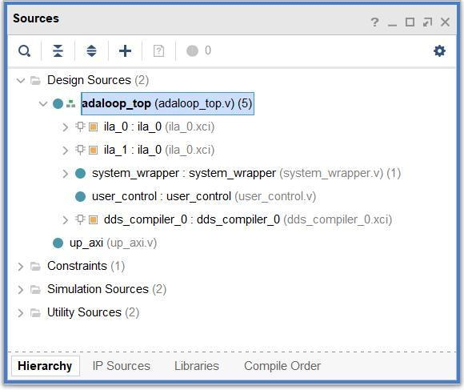
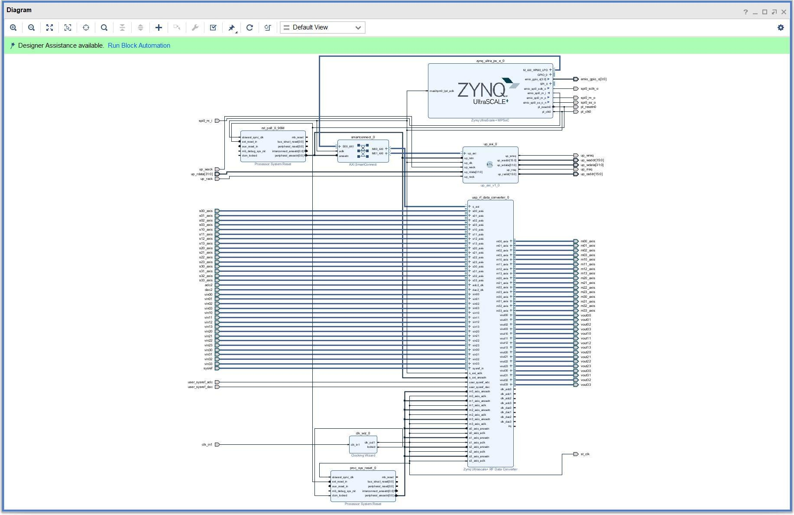
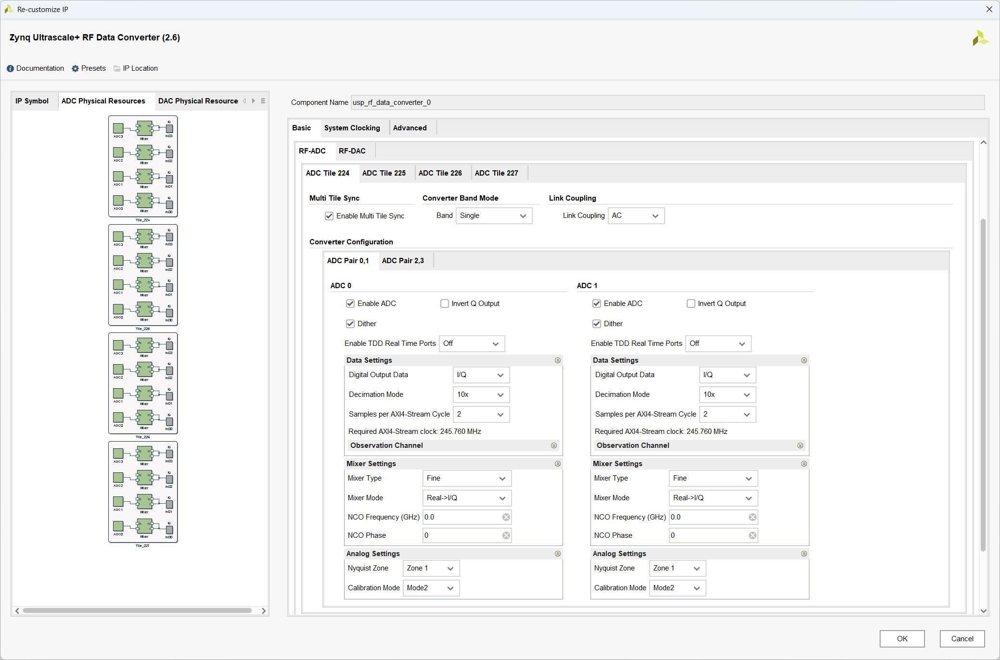
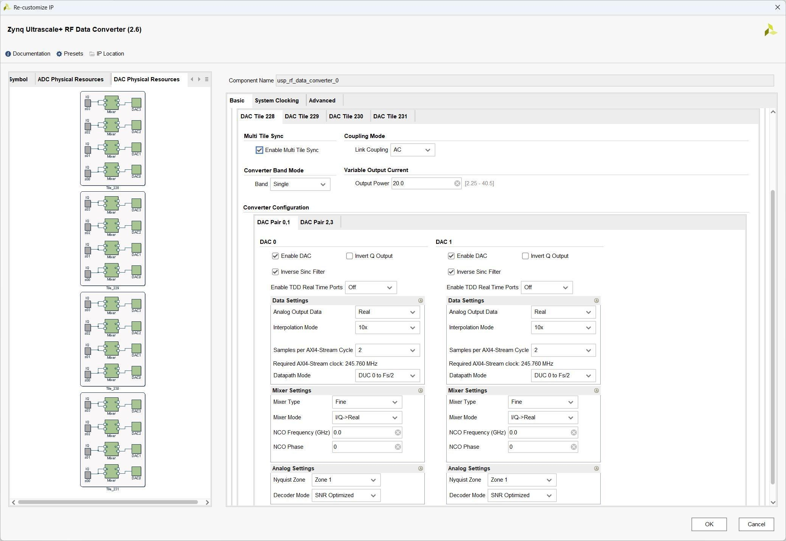
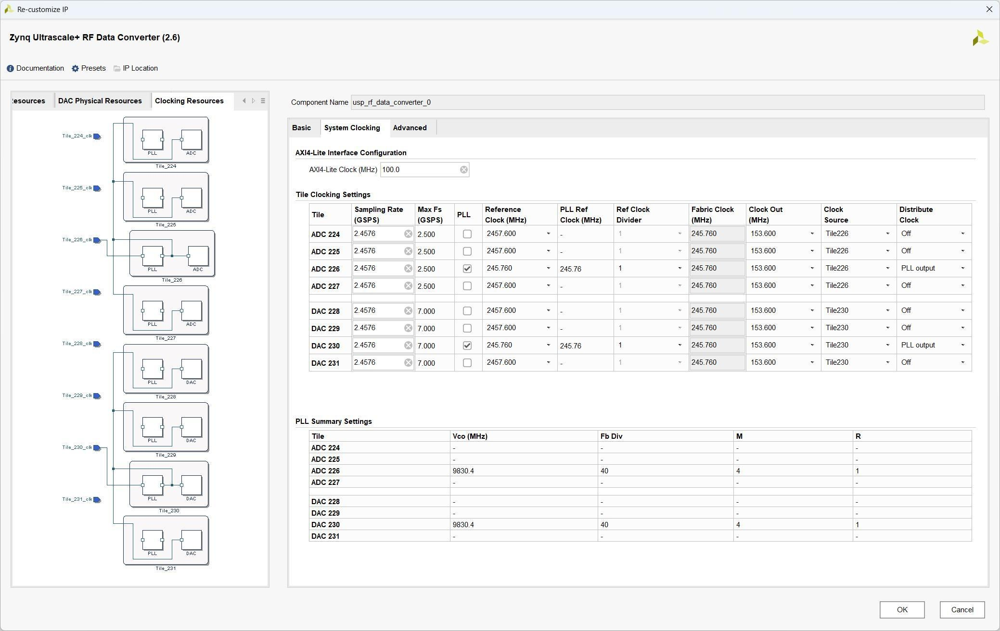

# 2.3 FPGA 硬件工程

[Switch to English](../../en/rf-development-guide/04-fpga-hardware-project.md)

步进衰减器设置。
RF-DAC
Enable Real Time Ports：启用 RF-DAC Fast Shutdown 和 pl_event 端口。
Enable Real Time NCO Ports：在 DUC 中，混频器的频率和相位可以实时修改。
选择此选项将启用 RF-DAC 的实时 NCO 端口。
Output Current：选择 20mA 和 32mA 的 RF-DAC 输出电流。在 20mA 模式下，
DAC_AVTT 等于 2.5V。在 32mA 模式下，DAC_AVTT 等于 3.0V。
Variable Output Current Mode（Gen3）可变输出电流模式（第三代）：当可变
输出电流模式关闭时，输出电流由输出电流选项设置。在 20mA 模式下，
DAC_AVTT 等于 2.5V。在 32mA 模式下，DAC_VATT 等于 3.0V。启用可变输
出模式后，可以通过 RF-DAC 选项卡中的可变输出电流字段在每个片的基础上
设置输出电流。DAC_AVTT 设置为 3.0V。
Enable Real Time Variable Output Power Ports（Gen3）：启用实时可变输出电源端
口（第三代），如果选择此选项，则会为每个启用的 RF-DAC 添加实时 VOP 信
号接口。这使得能够实时更新输出功率。

## 2.3 FPGA 硬件工程介绍

FPGA 硬件工程通过 Vivado2021.2 搭建，包括 PL 逻辑部分和 PS 处理器配
置部分。通过 SPI 配置 LMK04828 时钟芯片、Axi-Lite 配置 AD/DA 核、Axi-Lite
读写 PS PL 交互寄存器。
Vivado 打开工程，Source 界面如下所示：
文件解析：
文件名层级功能
adaloop_top 0 顶层文件，例化子模块
system_wrapper 1 BD 封装文件，包含 PS 和 RF 转换器模块
user_control 1 寄存器读写模块（目前没有用到）
dds_complier_0 1 dds ip 核，产生 RF-DAC 的 CW 测试源
ila_0/ila_1 1 Chipscope,观测 AD 信号
我们在 Vivado 软件里面打开 BD 文件 system，界面如下所示

里面主要三个模块 Zynq UltraScale+ MPSoC、usp_rf_data_converter_0 和 up_axi
模块。
模块名称功能
Zynq UltraScale+ MPSoC PS 部分，里面包含 PS 的外设配置
usp_rf_data_converter_0 RF 转换器模块，包含 AD/DA 的初始化配置
up_axi PS 通过 axi_lite 总线读写 PL 寄存器模块
其中，Zynq UltraScale+ MPSoC IP 核配置可以参考“RFEVM216 开发板 FPGA
基础教程”里面 IPI 设计部分，去配置相关参数。
RF 转换器配置
usp_rf_data_converter_0 是 RFSoC 的 AD/DA 硬核配置 IP 模块，用以配置时
钟链路、AD/DA 模式和 MTS 同步模式，这里面大多数参数可以通过 vitis/SDK
二次配置。
配置界面如下：
RF-ADC 配置
默认设定为 mixer 模式，射频实数输入，基带 IQ 输出。其他参数如频点范

围、抽取系数等都可以二次配置。
RF-DAC 配置
默认设定为 mixer 模式，基带 IQ 输入，射频实数输出。其他参数如频点范
围，抽取系数等都可以二次配置。

System Clcoking 配置
RFSoC 第三代支持多个 tile 共享参考时钟，这样对 MTS 多通道同步的实现
更加友好，本设计采用这种模式。四个发送通道共享 Bank230 参考时钟，四个
接收通道共享 Bank225 参考时钟。ADC/DAC 的采样率是 2.4576GHz，通过
LMK04828 时钟芯片输出的 245.76MHz 参考时钟锁相倍频实现。
Clock Out（MHz）选择 153.6MHz，axi_stream 总线的时钟计算与匹配的方式如
下：
ADC/DAC 的采样率为 2.4576GHz；
DAC0 是十倍插值 ， 总线上一个时钟 2 个样点 ， 则总线时钟为
2.4576/10=245.76MHz（注意这里 ADC 是 IQ 总线在一起的，所以一个时钟还是
1 个采样点）
ADC 是十倍抽取，总线上一个时钟 2 个样点（注意这里 ADC 是 IQ 总线在
一起的，所以一个时钟还是 1 个采样点）总线时钟为 2.4576/10=245.76MHz。
设计中采用一个 MMCM 把 ADC/DAC IP 输出的 153.6MHz 倍频到
245.76MHz 给基带系统做同步时钟。

