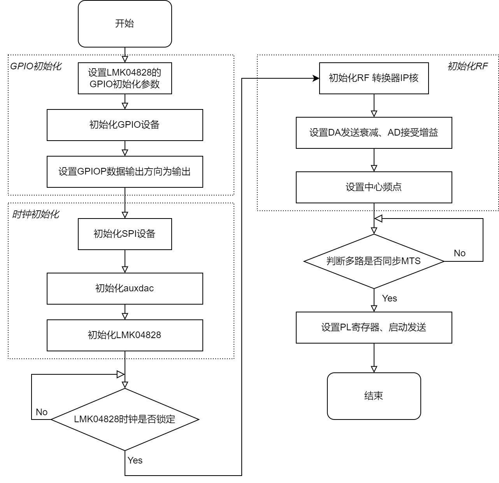

# 2.4 裸机应用程序

[Switch to English](../../en/rf-development-guide/05-bare-metal-application.md)

> 本章内容来自中文原始 PDF。图示和软件界面截图保留原标签，以便与硬件和软件实际界面对应。  
> Source PDF: `RFEVM216开发板射频开发指南s.pdf`  
> Source pages: 23-27

## 原 PDF 第 23 页

2.4 裸机应用程序  
裸机工程主要用来初始化 LMK04828 时钟芯片、初始化 RFSoC 配置、GPIO  
配置、与 PL 寄存器交互。  
软件配置流程如下图所示：  
1) 首先执行 platform_init(void)进行 GPIO 设备初始化设置方向并设定默认值。  
print("**************************************************\n\r");  
print("**********RFEVM216 CH16 begin MOD V3********\n\r");  
print("**************************************************\n\r");  
printf("Please wait...\n");  
platform_init();  
gpio_set_value(LMK_RESET, 0);  
mdelay(500);  
gpio_set_value(LMK_REF_SELECT0, 1); //TCXO REF2  
gpio_set_value(LMK_REF_SELECT1, 0);

### 图示

---

## 原 PDF 第 24 页

gpio_set_value(LMK_SYNC, 0);  
2) 配置 LMK04828 输出 RFSoC 所需设备时钟 245.76MHz 与 SYSREF（0.96MHz）  
时钟。  
/**********************************************************************  
****/  
/***** configure system clock  
*****/  
/**********************************************************************  
****/  
int32_t val;  
val = iic_init(IIC_DEVICE_ID);  
if (val == 0) {  
printf("IIC Setup PASSED\r\n");  
}  
uint8_t iicdata[2];  
for (int i = 0; i < sizeof(iicdata); i++) {  
i2c_reg_read(0x50, i, &iicdata[i]);  
mdelay(10);  
}  
auxdac = iicdata[0] | (iicdata[1] << 8);  
printf("auxdac value read from eeprom %d\n", auxdac);  
if (auxdac >= 2000 || auxdac < 1000)  
auxdac = 1600;  
lmk04828_init(&lmk04828_spi, 245.76e6);  
lmk04828_update_man_dac(&lmk04828_spi, auxdac);  
int32_t lock_pll1 = -1;  
int32_t lock_pll2 = -1;  
int cyc = 0;  
while ((lock_pll1 != 1 && ref_ext_en != 0) || lock_pll2 != 1 || cyc < 100)  
{  
lock_pll1 = lmk04828_spi_read(&lmk04828_spi, 0X182) >> 1 & 0x1;  
lock_pll2 = lmk04828_spi_read(&lmk04828_spi, 0X183) >> 1 & 0x1;  
printf("read from rf1_lmk04828 pll1_lock=0x%x\n", lock_pll1);  
printf("read from rf1_lmk04828 pll2_lock=0x%x\n", lock_pll2);  
if (lock_pll2 == 1 && (lock_pll1 == 1 || ref_ext_en == 0))  
cyc++;  
else  
cyc = 0;  
}  
printf("read from rf1_lmk04828 pll1_lock=0x%x\n", lock_pll1);  
printf("read from rf1_lmk04828 pll2_lock=0x%x\n", lock_pll2);  
mdelay(10);

---

## 原 PDF 第 25 页

val = lmk04828_spi_read(&lmk04828_spi, 0x184);  
printf("lmk04828_spi_rf1 0x184=%x\n",val);  
gpio_set_value(LMK_SYNC, 0);  
mdelay(1);  
gpio_set_value(LMK_SYNC, 1);  
mdelay(1);  
gpio_set_value(LMK_SYNC, 0);  
lmk04828_update_sysref_pulse(&lmk04828_spi);  
gpio_set_value(LMK_SYNC, 0);  
lmk04828_set_sysref_shots(&lmk04828_spi, 0);  
mdelay(1);  
mdelay(500);  
3) RFSoC 初始化  
Status = RFdcDcp_initial(&RFdcInstPtr, RFDC_DEVICE_ID);  
检测参考时钟  
Status = AXI_REG_READ(XPAR_XRFDC_0_BASEADDR,  
XRFDC_ADC_PATHS_ENABLED_OFFSET);  
printf("ADC_PATHS_ENABLED=%x\n", Status);  
Status = AXI_REG_READ(XPAR_XRFDC_0_BASEADDR,  
XRFDC_DAC_PATHS_ENABLED_OFFSET);  
printf("DAC_PATHS_ENABLED=%x\n", Status);  
uint32_t val_out;  
val_out = AXI_REG_READ(XPAR_XRFDC_0_BASEADDR, 0);  
printf("ip revision=%x\n", val_out);  
val_out = AXI_REG_READ(XPAR_XRFDC_0_BASEADDR, 0x18084);  
printf("adc tile1 clock_dector=%x\n", val_out);  
val_out = AXI_REG_READ(XPAR_XRFDC_0_BASEADDR, 0x1c084);  
printf("adc tile2 clock_dector=%x\n", val_out);  
val_out = AXI_REG_READ(XPAR_XRFDC_0_BASEADDR, 0x04084);  
printf("dac tile0 clock_dector=%x\n", val_out);  
val_out = AXI_REG_READ(XPAR_XRFDC_0_BASEADDR, 0x0c084);  
printf("dac tile2 clock_dector=%x\n", val_out);  
FS_DAC = RFdcInstPtr.DAC_Tile[0].PLL_Settings.SampleRate * 1e9;  
printf("DAC converter samplerate=%ldHz\n", FS_DAC);  
FS_ADC = RFdcInstPtr.ADC_Tile[0].PLL_Settings.SampleRate * 1e9;  
printf("ADC converter samplerate=%ldHz\n", FS_ADC);  
printf("****change DAC base samplerate to 2*FS_ADC %ldHz****\n", FS_ADC);

---

## 原 PDF 第 26 页

设定 DAC 发送频点  
double Freq_set = 500;  
uint32_t nco_nyquist;  
uint32_t datapath;  
if (Freq_set < (FS_DAC / 1e6 / 4)) {  
nco_nyquist = 1;  
datapath = 1;  
} else if (Freq_set < (FS_DAC / 1e6 / 2)) {  
nco_nyquist = 1;  
datapath = 1;  
} else if (Freq_set < (FS_DAC / 1e6 / 4 * 3)) {  
nco_nyquist = 2;  
datapath = 1;  
Freq_set = -Freq_set;  
} else {  
nco_nyquist = 2;  
datapath = 1;  
Freq_set = -Freq_set;  
}  
for (Tile_Id = 0; Tile_Id < 4; Tile_Id++) {  
for (Block_Id = 0; Block_Id < 4; Block_Id++) {  
Status = XRFdc_SetNyquistZone(&RFdcInstPtr, XRFDC_DAC_TILE,  
Tile_Id,  
Block_Id , nco_nyquist);  
if (Status != XST_SUCCESS)  
printf("Tile_Id=%d,Block_Id=%d,XRFdc_SetNyquistZone fail\n",  
Tile_Id, Block_Id);  
Status = XRFdc_SetDataPathMode(&RFdcInstPtr, Tile_Id, Block_Id,  
datapath);  
if (Status != XST_SUCCESS)  
printf("Tile_Id=%d,Block_Id=%d,XRFdc_SetDataPathMode  
fail\n",  
Tile_Id, Block_Id);  
Status = XRFdc_ChangeNCOFreq(&RFdcInstPtr, XRFDC_DAC_TILE,  
Tile_Id,  
Block_Id, Freq_set);  
if (Status != XST_SUCCESS)  
printf("Tile_Id=%d,Block_Id=%d,XRFdc_ChangeNCOFreq fail\n",  
Tile_Id, Block_Id);  
Status = XRFdc_GetMixerSettings(&RFdcInstPtr, XRFDC_DAC_TILE,  
Tile_Id,  
Block_Id , &Mixer_Settings);  
if (Status != XST_SUCCESS)  
printf("Tile_Id=%d,Block_Id=%d,XRFdc_GetMixerSettings

---

## 原 PDF 第 27 页

fail\n",  
Tile_Id, Block_Id);  
printf("DAC NCO frequency of Tile#%d Block%d is set to %f\n",  
Tile_Id, Block_Id, Mixer_Settings.Freq);  
}  
}  
设定 ADC 接收频点  
Freq_set = 500;  
if (Freq_set * 1e6 < (FS_ADC / 2)) {  
nco_nyquist = 1;  
Freq_set = -Freq_set;  
} else {  
nco_nyquist = 2;  
Freq_set = Freq_set;  
}  
for (Tile_Id = 0; Tile_Id < 4; Tile_Id++) {  
for (Block_Id = 0; Block_Id < 4; Block_Id++) {  
Status = XRFdc_SetNyquistZone(&RFdcInstPtr, XRFDC_ADC_TILE,  
Tile_Id,  
Block_Id, nco_nyquist);  
if (Status != XST_SUCCESS)  
printf("Tile_Id=%d,Block_Id=%d,XRFdc_SetNyquistZone fail\n",  
Tile_Id, Block_Id);  
Status = XRFdc_ChangeNCOFreq(&RFdcInstPtr, XRFDC_ADC_TILE,  
Tile_Id,  
Block_Id, Freq_set);  
if (Status != XST_SUCCESS)  
printf("Tile_Id=%d,Block_Id=%d,XRFdc_ChangeNCOFreq fail\n",  
Tile_Id, Block_Id);  
Status = XRFdc_GetMixerSettings(&RFdcInstPtr, XRFDC_ADC_TILE,  
Tile_Id, Block_Id, &Mixer_Settings);  
if (Status != XST_SUCCESS)  
printf("Tile_Id=%d,Block_Id=%d,XRFdc_GetMixerSettings  
fail\n",  
Tile_Id, Block_Id);  
printf("ADC NCO frequency of Tile#%d Block%d is set to %f\n",  
Tile_Id, Block_Id, Mixer_Settings.Freq);  
}  
}  
4) 设置发送功率  
设定接受的 DSA 衰减器，SettingsPtr.Attenuation=0 是不衰减，最大衰减为 27dB
