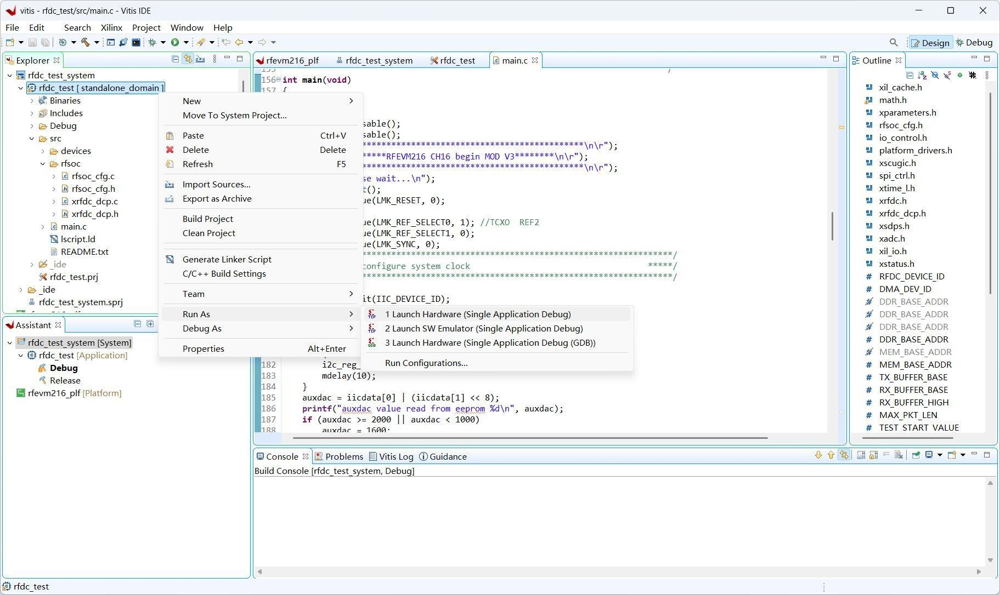
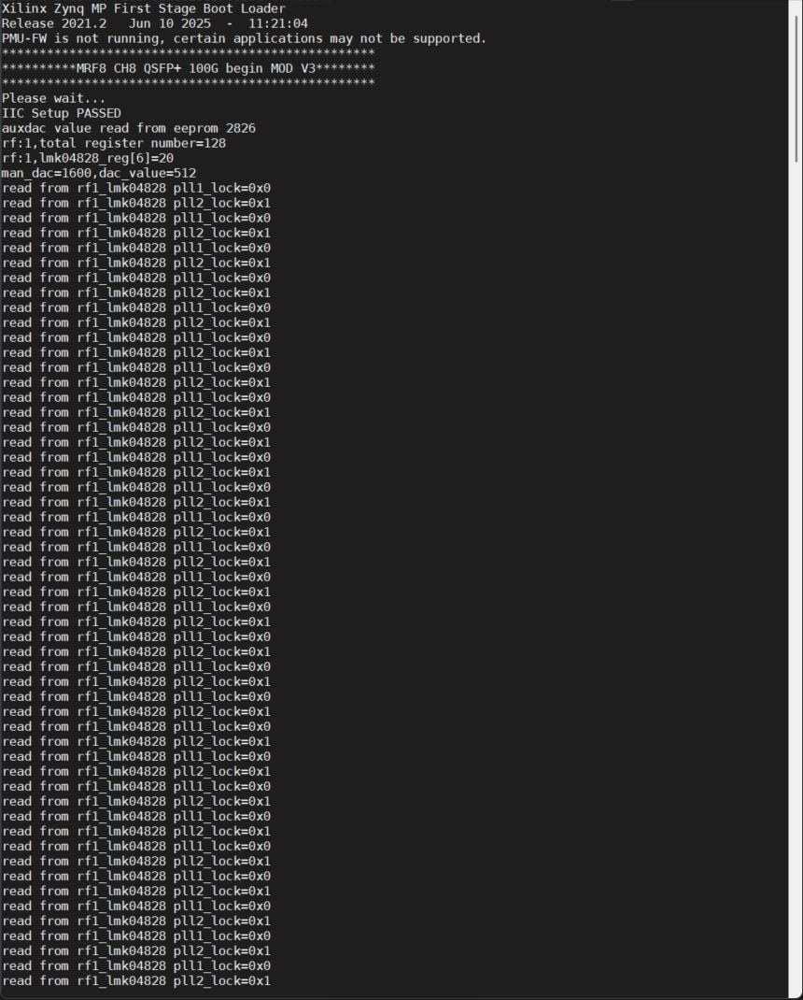
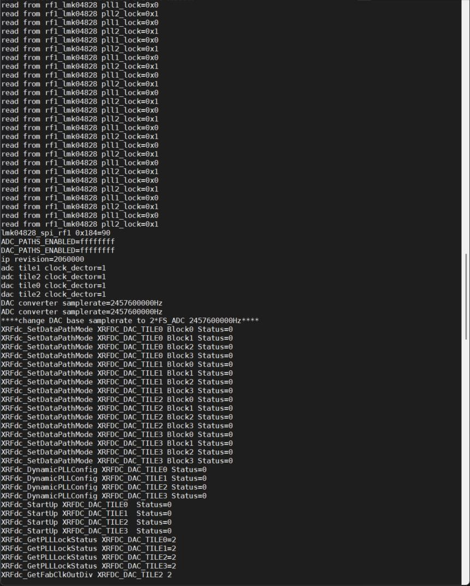
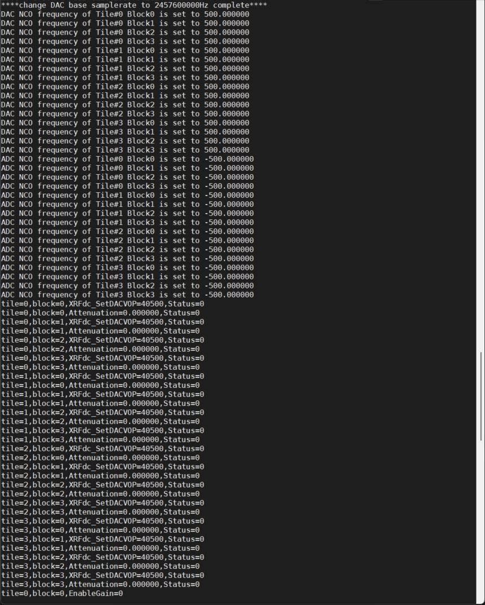
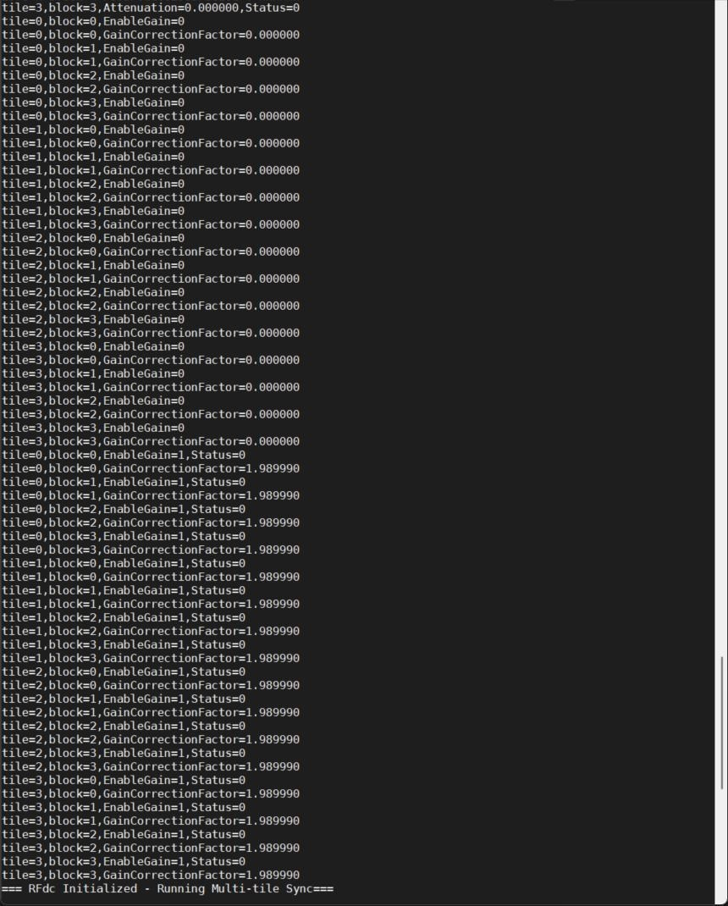
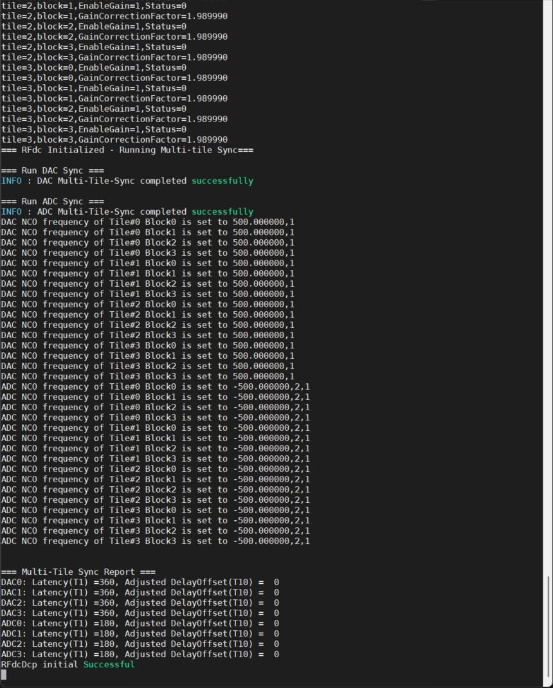
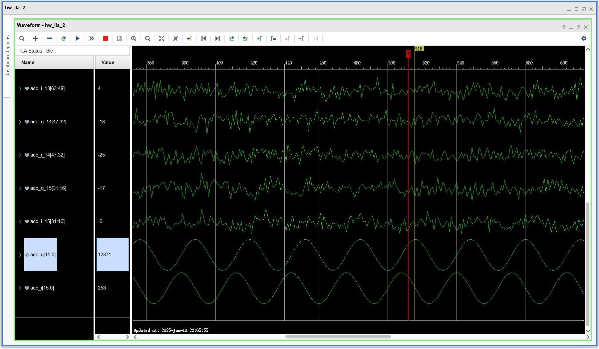

# 2.5 运行 Demo

[Switch to English](../../en/rf-development-guide/06-running-the-demo.md)

设定发送的 DAC 电流，40500（uA）是最大输出发射功率，最小为 2250uA，对
应的动态范围 25dB
SettingsPtr.Attenuation = 0;
SettingsPtr.DisableRTS = 1;
uint32_t txatt_ua;
for (int i = 0; i < 4; i++)
for (int j = 0; j < 4; j++) {
txatt_ua = round(40500/ pow(10, ((double)txatt[i * 2 + j]/ 1000) /
20));
Status = XRFdc_SetDACVOP(&RFdcInstPtr, i, j, txatt_ua);
printf("tile=%d,block=%d,XRFdc_SetDACVOP=%d,Status=%d\n", i, j,
txatt_ua,Status);
Status = XRFdc_SetDSA(&RFdcInstPtr, i, j, &SettingsPtr);
Status = XRFdc_GetDSA(&RFdcInstPtr, i, j, &SettingsPtr);
Status = XRFdc_SetDither(&RFdcInstPtr, i, j, 1);
printf("tile=%d,block=%d,Attenuation=%f,Status=%d\n", i, j,
SettingsPtr.Attenuation, Status);
}

5. MTS 同步

在 RFdcDcp_Example 里面进行多 tile 间的同步操作。
Status=-1;
while (Status != XRFDC_SUCCESS) {
// Status = ChangeSampleFreq(&RFdcInstPtr, sample_rate);
Status = qmc_settings(&RFdcInstPtr, XRFDC_ADC_TILE);
mdelay(100);
Status = RFdcDcp_Example(&RFdcInstPtr, &lmk04828_spi);
if (Status != XRFDC_SUCCESS) {
printf("RFdcDcp initial failed\n");
}
}

## 2.5 运行 demo 例程

1. 连接 12v 直流电源，Type-C 调试线缆插好，板卡上电；
2. Vitis 中直接运行应用程序；

注：vitis 工程对路径比较敏感，当 vitis 工程复制到其他路径后，编译或者下
载会提示一些错误，这时简单的做法可以在 vitis 里面把 rfevm216_plf 删掉，
重新建个 platform，起名 rfevm216_plf，里面参数默认即可。xsa 文件选工程
下面的文件按即可。

3. 打开串口调试终端，串口配置为：波特率 115200，8 数据位，1 开始，1 停

止；
串口打印信息如下所示：

[本页无可提取文本。]

[本页无可提取文本。]

[本页无可提取文本。]

[本页无可提取文本。]

4. 通过回环射频缆将 TX0 和 RX0 回环，通过 chipscope 看到射频回环的结果

注：这里观察了每一路的采样点。

