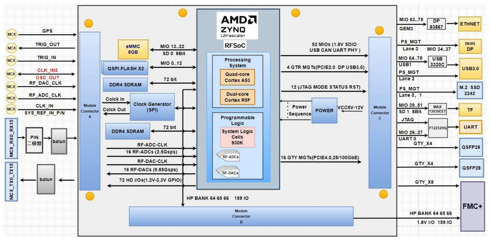

# 1. 简介

[Switch to English](../../en/user-guide/01-introduction.md)

RFEVM216 开发板由 RFSOM216 核心板和载板构成，核心板和载板之间使
用高速板间连接器连接。
RFSOM216 核心板 ZYNQ 芯片采用 Xilinx 公司的 ZynqTM UltraScale+TM
RFSoC Gen3 系列 ZU49DR FPGA 主芯片，它支持 16 路 14 位 RF-ADC，最大采
样率可达 2.5GSPS，16 路 14 位 RF-DAC，最高采样率可达 9.85GSPS 。可以降
低 RF 信号处理链的复杂性，最大化输入/输出通道密度，而不会牺牲宽带并利用
异构处理能力，并且拥有更低的功耗（取消了 ADC/DAC 组件，消除了 FPGA 至
模拟的接口功耗）。Zynq UltraScale+器件中提供 ARM Cortex-A53 处理子系统、
UltraScale+可编程逻辑和最高信号处理带宽，能够提供综合 RF 信号链，满足无
线、有线电视接入、测试测量、早期预警/雷达以及其它高性能 RF 应用需求。
RFSOM216 核心板使用了 10 片 Micron 公司的 DDR4 芯片
MT40A512M16LY，PS 端挂载 5 片，组成 64 为数据总线宽度，带 ECC 功能，
PL 端挂载 5 片 DDR4 芯片，组成 72 位数据总线位宽。核心板也集成了 1Gb 大
小的 QSPI FLASH 和 8GB 的 EMMC 用于启动存储配置和系统文件。
载板为核心板扩展了丰富的外围接口，其中主要包含 1 路 M.2 NVMe 接口、
一路 USB3.0 接口、1 路千兆以太网接口、一路 JTAG/UART 接口、一路 TF 卡接
口、一路 FMC+扩展接口和两路 QSFP28 接口等。
下图为整个开发系统的结构示意图：

图 1 RFEVM216 开发板
通过这个示意图，我们可以看到 RFEVM216 开发平台所能包含的接口和功
能。

- RFSOM216 核心板

由 ZU49DR+4GB DDR4（PS）+4GB DDR4（PL）+1Gb QSPI Flash+8GB eMMC
组成，另外核心模块提供双晶振时钟源，一个单端 33.3333MHz 有源晶振提供给
PS 系统，一个晶体 32.76KHz 驱动 RFSOC 内部 RTC 电路。

- M.2 接口

一路 PCIe x2 标准的 M.2 接口，用于连接 M.2 的 SSD 固态硬盘。

- USB3.0 接口

一路 USB3.0 接口，支持 HOST、SLAVE 三种模式。

- 千兆以太网接口

一路 10M/100M/1000M 以太网 RJ45 接口，用于和电脑或者其它网络设备行
以太网数据交换。

- JTAG&UART 接口

JTAG&UART 调试接口类型为 Type-C 接口，JTAG 和 UART 共用此接口，用
于 FPGA 程序的下载和调试。

- Micro SD 卡座

一路 Micro SD 卡座，用于存储操作系统镜像和文件系统。

- FMC+扩展接口

一路 FMC+扩展接口，用于扩展其他 FMC 子卡。

- QSFP28 光纤接口

两路 QSFP28 光纤接口，支持 40G/100G 的通信速率。

- 扩展 IO

三组扩展 IO，两组 PL 端扩展 IO，一组 PS 端扩展 IO，可供用户自定义使用。

- LED 灯

4 个可扩展的 LED 直插针座，供用户自定义使用。

- 板对板与夹层连接器

2 组 80P 5mm 板对板与夹层连接器。
