# 3. 载板

[Switch to English](../../en/user-guide/03-carrier-board.md)

载板接口与连接器的可检索表格请参阅[管脚映射参考](04-pin-mapping.md#carrier-pin-mapping)。

## 3.1 简介

通过前面的功能介绍，我们可以了解到载板的部分功能

- 1 路 M.2 接口
- 1 路 USB3.0 接口
- 1 路千兆以太网接口
- 1 路 JTAG&UART 的 Type-C 接口
- 1 路 Micro SD 卡座
- 1 路 DP 接口
- 2 路 QSFP28 光口
- 2 组 PL 扩展 IOx8，1 组 PS 扩展 IO
- 4 个用户 LED 灯
- 1 路 FMC+扩展接口

## 3.2 M.2 接口

RFEVM216 开发板配备了一个 PCIE x2 标准的 M.2 接口，用于连接 M.2 的
SSD 固态硬盘。M.2 接口使用 M key 插槽，只支持 PCI-E，不支持 SATA，用户

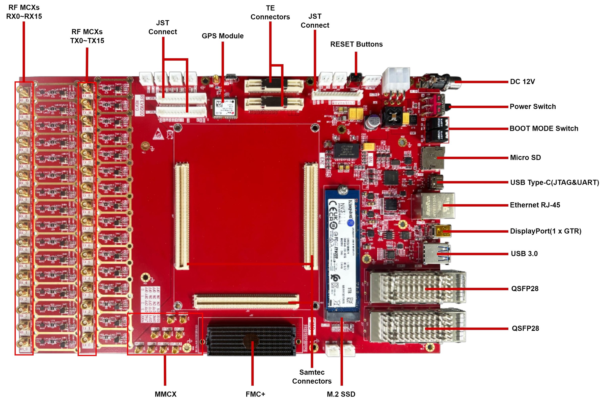

选择 SSD 固态硬盘的时候需要选择 PCIE 类型的 SSD 固态硬盘。
PCIE 信号直接跟 ZU47DR 的 BANK505 PS MGT 收发器相连接，2 路 TX 信
号和 RX 信号都是以差分信号方式连接到 MGT 的 LANE0、LANE1 上。PCIE 的
时钟由 100MHz 的差分时钟提供，M.2 电路设计示意图如下所示：
图 15 M.2 接口设计示意图
表 8 M.2 接口 ZYNQ 引脚分配
信号名称 ZYNQ 引脚号
M.2 连接器 J19
引脚号名称
MGT_TX0_N AH36 47 PETn0
MGT_TX0_P AH35 49 PETp0
MGT_TX1_N AG38 35 PETn1
MGT_TX1_P AG37 37 PETp1
MGT_RX0_N AJ42 41 PERn0
MGT_RX0_P AJ41 43 PERp0
MGT_RX1_N AH40 29 PERn1
MGT_RX1_P AH39 31 PERp1
MGT_CLK0_N AF35
MGT_CLK0_P AF34

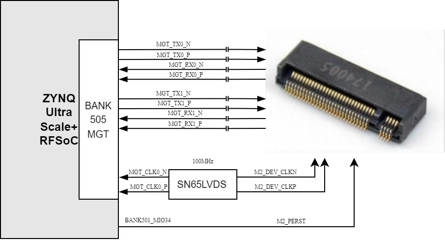

## 3.3 USB3.0 接口

RFEVM216 载板上扩展 1 个 USB3.0 接口，支持 HOST、SLAVE 工作模式，
数据传输速率高达 5.0Gb/s。USB3.0 直接和外部 Type-A 接口连接，USB2.0 通过
ULPI 接口连接外部 USB3320C 芯片，实现高速的 USB3.0 和 USB2.0 数据通信。
USB3.0 连接示意图如下：
图 16 USB3.0 接口示意图
表 9 USB 接口引脚分配
信号名称引脚名 ZYNQ 引脚号备注
USB_TX_N BANK505_MGT_TX2_N AF40 USB3.0 数据发送负
USB_TX_P BANK505_MGT_TX2_P AF39 USB3.0 数据发送正
USB_RX_N BANK505_MGT_RX2_N AG42 USB3.0 数据接送负
USB_RX_P BANK505_MGT_RX2_P AG41 USB3.0 数据接送正
USB_DATA0 BANK502_PS_MIO56 N29 USB2.0 数据 Bit0
USB_DATA1 BANK502_PS_MIO57 R29 USB2.0 数据 Bit1
USB_DATA2 BANK502_PS_MIO54 N28 USB2.0 数据 Bit2
USB_DATA3 BANK502_PS_MIO59 T30 USB2.0 数据 Bit3

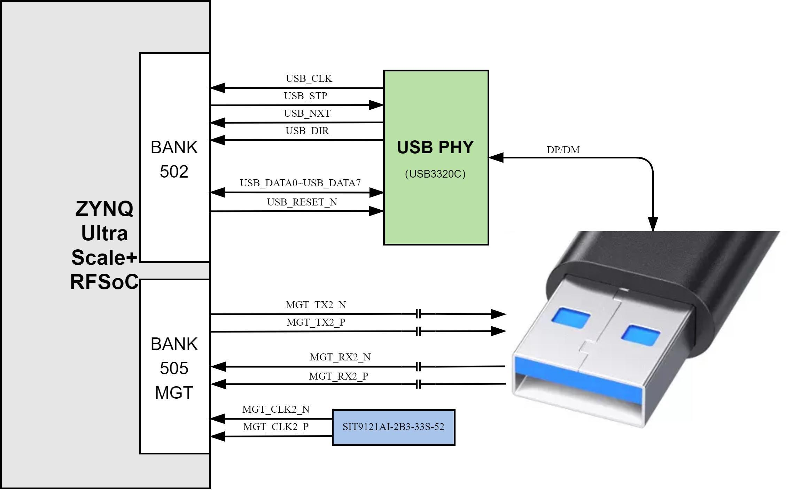

USB_DATA4 BANK502_PS_MIO60 U28 USB2.0 数据 Bit4
USB_DATA5 BANK502_PS_MIO61 T28 USB2.0 数据 Bit5
USB_DATA6 BANK502_PS_MIO62 V28 USB2.0 数据 Bit6
USB_DATA7 BANK502_PS_MIO63 T29 USB2.0 数据 Bit7
USB_STP BANK502_PS_MIO58 R30 USB2.0 停止信号
USB_DIR BANK502_PS_MIO53 N30 USB2.0 数据方向信号
USB_CLK BANK502_PS_MIO52 P28 USB2.0 时钟信号
USB_NXT BANK502_PS_MIO55 P29 USB2.0 下一个数据信号
USB_RESET_N BANK501_PS_MIO35 C33 USB2.0 复位信号

## 3.4 千兆以太网接口

RFEVM216 载板上有 1 路千兆以太网接口连接到 PS 端。以太网芯片采用
Ti 公司的 DP83867ISR 芯片为用户提供网络通信服务。PS 端的以太网 PHY 芯片
连接到 ZYNQ 的 PS 端 BANK502 的 MIO 上。DP83867 芯片支持 10/100/1000 Mbps
网络传输速率，通过 RGMII 接口跟 ZYNQ 系统的 MAC 层进行数据通信。千兆
以太网 PHY 芯片连接示意图如下图所示：
图 17 以太网连接示意图
表 10 DP83867ISR PHY 连接到 XCZU49DR RFSoC

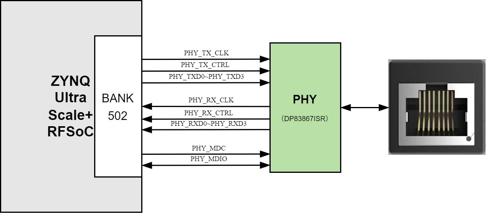

信号名称引脚名引脚号
DP83867 PHY U48
引脚号引脚名
PHY_TX_CLK BANK502_PS_MIO64 U30 29 GTX_CLK
PHY_TXD0 BANK502_PS_MIO65 V30 28 TX_D0
PHY_TXD1 BANK502_PS_MIO66 V29 27 TX_D1
PHY_TXD2 BANK502_PS_MIO67 W28 26 TX_D2
PHY_TXD3 BANK502_PS_MIO68 Y29 25 TX_D3
PHY_TX_CTRL BANK502_PS_MIO69 W29 37 TX_CTRL
PHY_RX_CLK BANK502_PS_MIO70 AA28 32 RX_CLK
PHY_RXD0 BANK502_PS_MIO71 AB28 33 RX_D0
PHY_RXD1 BANK502_PS_MIO72 AC28 34 RX_D1
PHY_RXD2 BANK502_PS_MIO73 AA29 35 RX_D2
PHY_RXD3 BANK502_PS_MIO74 Y30 36 RX_D3
PHY_RX_CTRL BANK502_PS_MIO75 AC29 38 RX_CTRL
PHY_MDC BANK502_PS_MIO76 AB30 16 MDC
PHY_MDIO BANK502_PS_MIO77 AA30 17 MDIO
PS_POR_B BANK501_PS_MIO26 A34 43 RESET_N

## 3.5 Micro SD 卡座

RFEVM216 载板包含一个 Micro SD 卡接口，以提供用户访问 SD 卡存储器，
用于存储 BOOT 程序、Linux 操作系统内核、文件系统以及其它的用户数据文件。
SD 卡 IO 信号与 PS BANK501 的 MIO 信号相连，PS 和 SD 卡连接器连接示
意图如下如所示：
图 18 SD 卡连接示意图
表 11 SD 卡引脚分配
信号名称引脚名引脚号备注
SDIO_CLK BANK501_PS_MIO51 M31 SD 时钟信号
SDIO_CMD BANK501_PS_MIO50 M30 SD 命令信号
SDIO_DAT0 BANK501_PS_MIO46 J31 SD 数据 Bit0
SDIO_DAT1 BANK501_PS_MIO47 L32 SD 数据 Bit1
SDIO_DAT2 BANK501_PS_MIO48 M32 SD 数据 Bit2
SDIO_DAT3 BANK501_PS_MIO49 K31 SD 数据 Bit3
SDIO_DETECT BANK501_PS_MIO45 L30 SD 卡检测信号

## 3.6 DP 显示接口

RFEVM216 载板上带有 1 路 mini DisplayPort 输出显示接口，用于视频图像
的显示，接口支持 VESA DisplayPort V1.2a 输出标准。
DisplayPort 数据传输通道直接用 RFEVM216 的 BANK505 PS MGT 驱动输
出，MGT 的 LANE3 信号以差分信号方式连接到 DP 连接器。DisplayPort 辅助通
道连接到 PS 的 MIO 管教上。DP 输出接口设计的示意图如下所示。

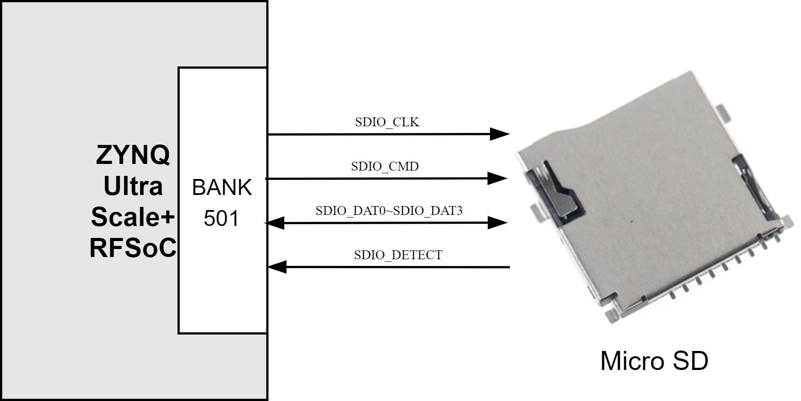

表 12 DisplayPort 与 ZYNQ 引脚分配
信号名称引脚名引脚号备注
GT0_DP_TX_P PS_MGT_TX3_P AE37 DP 数据发送正
GT0_DP_TX_N PS_MGT_TX3_N AE38 DP 数据发送负
PS_MGT_DP_CLK_P PS_MGT_CLK3_P AB34 DP 参考时钟正
PS_MGT_DP_CLK_N PS_MGT_CLK3_N AB35 DP 参考时钟负
DP_AUX_OUT BANK501_PS_MIO27 B34 DP 辅助数据输出
DP_AUX_IN BANK501_PS_MIO30 C34 DP 辅助数据输入
DP_OE BANK501_PS_MIO29 B33 DP 辅助数据输出使能
DP_HPD BANK501_PS_MIO28 A33 DP 插入信号检测

## 3.7 光纤接口

RFEVM216 载板上有 2 路 QSFP28 光纤接口。2 路光纤接口分别跟 ZYNQ
的 BANK130、BAN131 上的 GTY 收发器相连接。BANK130 的 2 个参考时钟分
别由 RFSOM216 核心板的 LMK04828 芯片（可配置）和载板上的差分晶振
（ 156.25MHz ） 提供 。 BANK131 的参考时钟由载板上的差分晶振提供
156.25MHz。
QSFP28 接口连接示意图如下图所示：

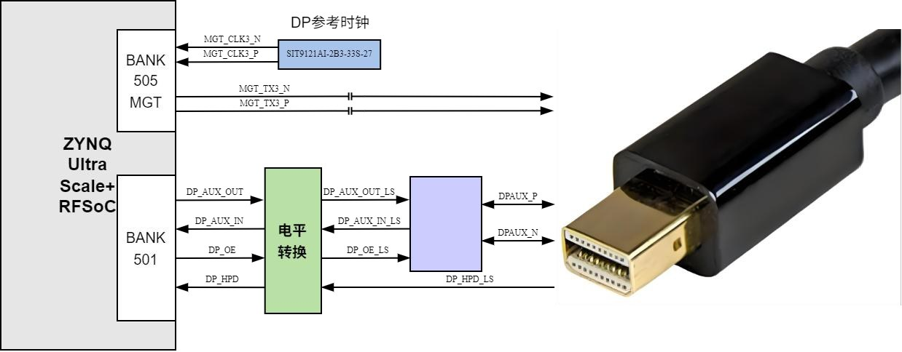

图 19 光纤设计示意图
表 13 J12 QSFP 接口引脚分配
信号名称 ZYNQ 引脚名 ZYNQ 引脚号备注
QSFP_RX0_N MGTYRXN0_130 L42
QSFP_RX0_P MGTYRXP0_130 L41
QSFP_RX1_N MGTYRXN1_130 J42
QSFP_RX1_P MGTYRXP1_130 J41
QSFP_RX2_N MGTYRXN2_130 G42
QSFP_RX2_P MGTYRXP2_130 G41
QSFP_RX3_N MGTYRXN3_130 F40
QSFP_RX3_P MGTYRXP3_130 F39

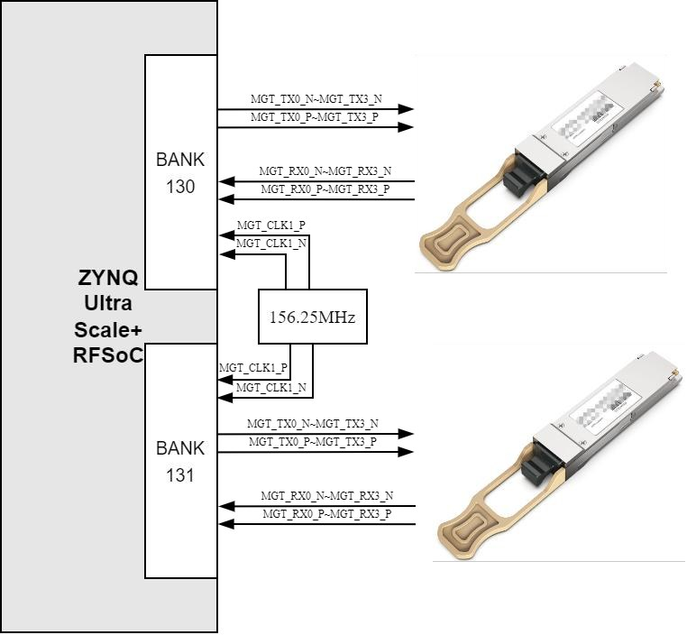

QSFP_TX0_N MGTYTXN0_130 K39
QSFP_TX0_P MGTYTXP0_130 K38
QSFP_TX1_N MGTYTXN1_130 J37
QSFP_TX1_P MGTYTXP1_130 J36
QSFP_TX2_N MGTYTXN2_130 H39
QSFP_TX2_P MGTYTXP2_130 H38
QSFP_TX3_N MGTYTXN3_130 G37
QSFP_TX3_P MGTYTXP3_130 G36
表 14 J14 QSFP 接口引脚分配
信号名称 ZYNQ 引脚名 ZYNQ 引脚号备注
QSFP_RX0_N MGTYRXN0_131 E42
QSFP_RX0_P MGTYRXP0_131 E41
QSFP_RX1_N MGTYRXN1_131 D40
QSFP_RX1_P MGTYRXP1_131 D39
QSFP_RX2_N MGTYRXN2_131 C42
QSFP_RX2_P MGTYRXP2_131 C41
QSFP_RX3_N MGTYRXN3_131 B40
QSFP_RX3_P MGTYRXP3_131 B39
QSFP_TX0_N MGTYTXN0_131 F35
QSFP_TX0_P MGTYTXP0_131 F34
QSFP_TX1_N MGTYTXN1_131 E37\
QSFP_TX1_P MGTYTXP1_131 E36
QSFP_TX2_N MGTYTXN2_131 C37
QSFP_TX2_P MGTYTXP2_131 C36
QSFP_TX3_N MGTYTXN3_131 A37
QSFP_TX3_P MGTYTXP3_131 A36
表 15 参考时钟分配
ZYNQ 引脚名 ZYNQ 引脚号备注
MGTREFCLK0N_130 P35 LMK04828 的 SDCLKOUT5 输出
MGTREFCLK0P_130 P34 LMK04828 的 SDCLKOUT5 输出
MGTREFCLK1N_130 M35 载板 156.25MHz 晶振差分输出
MGTREFCLK1P_130 M34 载板 156.25MHz 晶振差分输出
MGTREFCLK1N_131 H35 载板 156.25MHz 晶振差分输出
MGTREFCLK1P_131 H34 载板 156.25MHz 晶振差分输出
表 16 J12 光纤低速 IO 信号处理方式
QSFP 低速 IO 信号名备注 SFP 低速 IO 信号名备注
SCL 上拉 3.3v TX_FULT 上拉 3.3v
SDA 上拉 3.3v TX_DISABLE 接地
ModSeIL 上拉 3.3v RATE_SELECT0 上拉 3.3v
ResetL 上拉 3.3v RATE_SELECT1 上拉 3.3v
ModPrsl 上拉 3.3v LOS 上拉 3.3v
intL 上拉 3.3v
LPMode 接地
表 17 J14 光纤低速 IO 信号处理方式
QSFP 低速 IO 信号名备注 SFP 低速 IO 信号名备注
SCL 上拉 3.3v TX_FULT 上拉 3.3v
SDA 上拉 3.3v TX_DISABLE 接地
ModSeIL 上拉 3.3v RATE_SELECT0 上拉 3.3v
ResetL 上拉 3.3v RATE_SELECT1 上拉 3.3v
ModPrsl 上拉 3.3v LOS 上拉 3.3v
intL 上拉 3.3v
LPMode 接地

## 3.8 JTAG&UART 接口

RFEVM216 载板上预留了一个 JTAG&UART 接口，用于下载调试 FPGA 程
序或者固化程序到 FLASH。我们这里使用了 FTDI 的第 5 代 USB 设备芯片
FT2232H 芯片，它是一个 USB2.0 高速至 UART/FIFO 芯片，有两个多协议同步
串行引擎允许使用 JTAG。具有在多种工业标准串行或并行接口配置的能力。
JTAG&UART 连接示意图如下图所示：
图 20 JTAG&UART 连接器连接示意图

## 3.9 GPS 模块

RFEVM216 载板可以配有 GPS 模块 NEO-M8N，这是一款高性能的 GNSS
接收器模块，具有卓越的定位精度和灵敏度。该模块采用了最新的 u-blox M8 芯
片，支持 GPS、GLONASS、BeiDou、Galileo 等多种卫星系统，能够提供全球范
围内的定位数据。GPS 连接示意图如下图所示：
信号名称引脚名引脚号备注
UART0_TX BANK501_PS_MIO39 J32 PS Uart 数据输出
UART0_RX BANK501_PS_MIO38 G32 PS Uart 数据输入

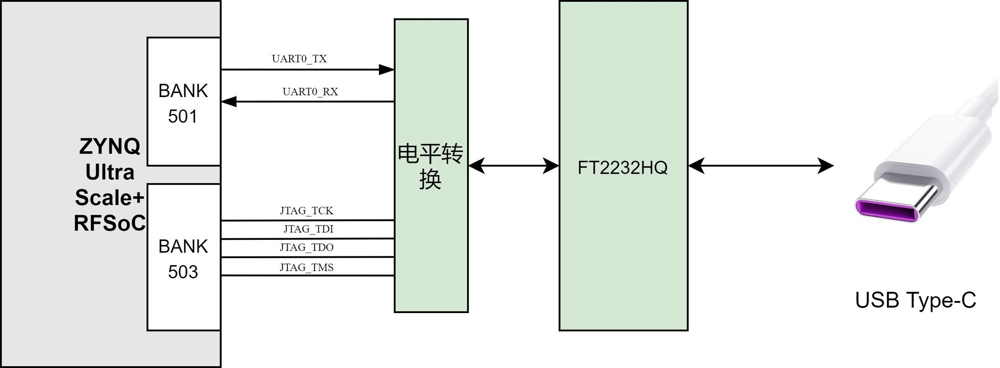

图 21 GPS 模块连接示意图
表 18 GPS 模块引脚分配
信号名称引脚名引脚号备注
PPS_1S_GPS IO_L4N_AD12N_88 L17 TIMEPLUSE
TXD_GPS BANK501_PS_MIO40 F32 TXD_MISO
RXD_GPS BANK501_PS_MIO41 K32 RXD_MOSI

## 3.10 FMC+接口

RFEVM216 带有 1 各 FMC+ 的扩展口 ， 可以外接 XILINX 或者其他的
FMC/FMC+模块。其中 FMC+扩展口包含 69 对差分 IO 信号和 8 组 GTY 收发器
信号。
FMC+扩展口的 69 对差分信号连接到了 ZYNQ 芯片的 BANK64，65、66 的
IO 上，电平标准为 1.8V，差分信号支持 LVDS 数据通信。8 组 GTY 收发器信号
连接到 BANK128 和 BANK129。

## 3.11 板对板高速连接器

RFEVM216 带有 2 路板端矩形连接器，表贴 80PIN、0.8mm 间距，配合高
度 5mm。

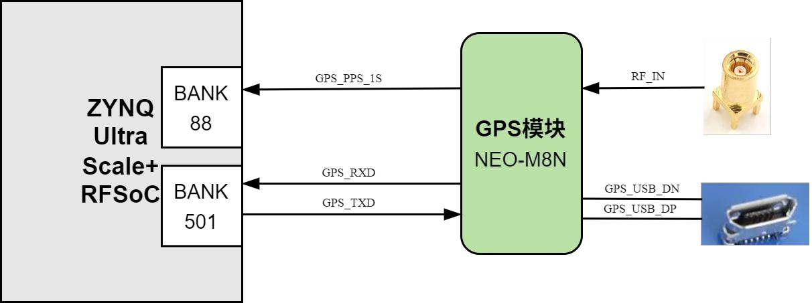

表 19 J3 连接器管脚分配
信号名称 J3 序号引脚名引脚号备注
HD_IO_C_P4 3 IO_L2P_AD10P_89 J12
HD_IO_C_N4 5 IO_L2N_AD10N_89 J11
HD_IO_C_P5 9 IO_L11P_AD1P_89 C10
HD_IO_C_N5 11 IO_L11N_AD1N_89 B10

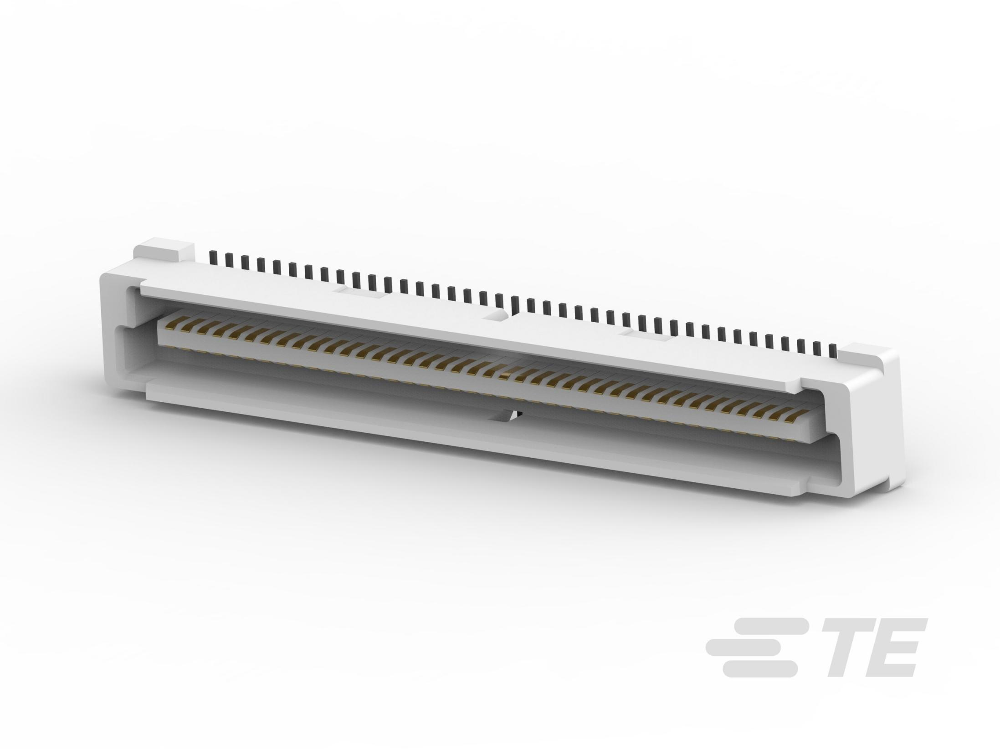

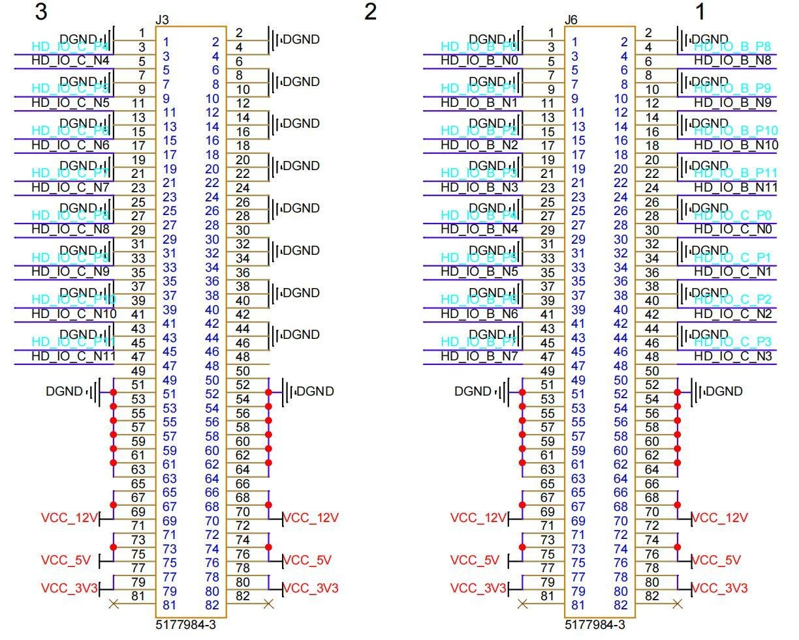

HD_IO_C_P6 15 IO_L12P_AD0P_89 A10
HD_IO_C_N6 17 IO_L12N_AD0N_89 A9
HD_IO_C_P7 21 IO_L7P_HDGC_AD5P_89 E10
HD_IO_C_N7 23 IO_L7N_HDGC_AD5N_89 E9
HD_IO_C_P8 27 IO_L12P_AD0P_89 H11
HD_IO_C_N8 29 IO_L12N_AD0N_89 G10
HD_IO_C_P9 33 IO_L3P_AD9P_89 H10
HD_IO_C_N9 35 IO_L3N_AD9N_89 H9
HD_IO_C_P10 39 IO_L9P_AD3P_89 D9
HD_IO_C_N10 41 IO_L9N_AD3N_89 C9
HD_IO_C_P11 45 IO_L5P_HDGC_AD7P_89 G12
HD_IO_C_N11 47 IO_L5N_HDGC_AD7N_89 G11
表 20 J6 连接器管脚分配
信号名称 J6 序号引脚名引脚号备注
HD_IO_B_P0 3 IO_L6P_HDGC_87 F15
HD_IO_B_N0 5 IO_L6N_HDGC_87 E14
HD_IO_B_P1 9 IO_L7P_HDGC_87 C15
HD_IO_B_N1 11 IO_L7N_HDGC_87 C14
HD_IO_B_P2 15 IO_L8P_HDGC_87 B16
HD_IO_B_N2 17 IO_L8N_HDGC_87 B15
HD_IO_B_P3 21 IO_L11P_AD9P_87 A15
HD_IO_B_N3 23 IO_L11N_AD9N_87 A14
HD_IO_B_P4 27 IO_L10P_AD10P_87 D16
HD_IO_B_N4 29 IO_L10N_AD10N_87 C16
HD_IO_B_P5 33 IO_L3P_AD13P_87 D14
HD_IO_B_N5 35 IO_L3N_AD13N_87 C13
HD_IO_B_P6 39 IO_L5P_HDGC_87 A13
HD_IO_B_N6 41 IO_L5N_HDGC_87 A12
HD_IO_B_P7 45 IO_L9P_AD11P_87 E16
HD_IO_B_N7 47 IO_L9N_AD11N_87 E15
HD_IO_B_P8 4 IO_L1P_AD15P_87 F12
HD_IO_B_N8 6 IO_L1N_AD15N_87 E12
HD_IO_B_P9 10 IO_L12P_AD8P_87 F14
HD_IO_B_N9 12 IO_L12N_AD8N_87 F13
HD_IO_B_P10 16 IO_L2P_AD14P_87 D13
HD_IO_B_N10 18 IO_L2N_AD14N_87 D12
HD_IO_B_P11 22 IO_L4P_AD12P_87 B13
HD_IO_B_N11 24 IO_L4N_AD12N_87 B12
HD_IO_C_P0 28 IO_L8P_HDGC_AD4P_89 E11
HD_IO_C_N0 30 IO_L8N_HDGC_AD4N_89 D11
HD_IO_C_P1 34 IO_L6P_HDGC_AD6P_89 F10
HD_IO_C_N1 36 IO_L6N_HDGC_AD6N_89 F9
HD_IO_C_P2 40 IO_L10P_AD2P_89 C11
HD_IO_C_N2 42 IO_L10N_AD2N_89 B11
HD_IO_C_P3 46 IO_L1P_AD11P_89 K12
HD_IO_C_N3 48 IO_L1N_AD11N_89 K11

## 3.12 扩展 IO 和 LED 灯

RFEVM216 载板扩展了 2 组 PL 端 IO（x7、x8），一组 PS 端 IO（x8）。
图 22 扩展 IO 电路连接图
表 21 J9 扩展 IO 管脚分配
信号名称引脚名引脚号备注
HD_IO_A_P2 IO_L9P_AD11P_88 J14
HD_IO_A_N2 IO_L9N_AD11N_88 J13
HD_IO_A_P3 IO_L6P_HDGC_88 K15
HD_IO_A_N3 IO_L6N_HDGC_88 K14
HD_IO_A_P4 IO_L10P_AD10P_88 H13
HD_IO_A_N4 IO_L10N_AD10N_88 G13

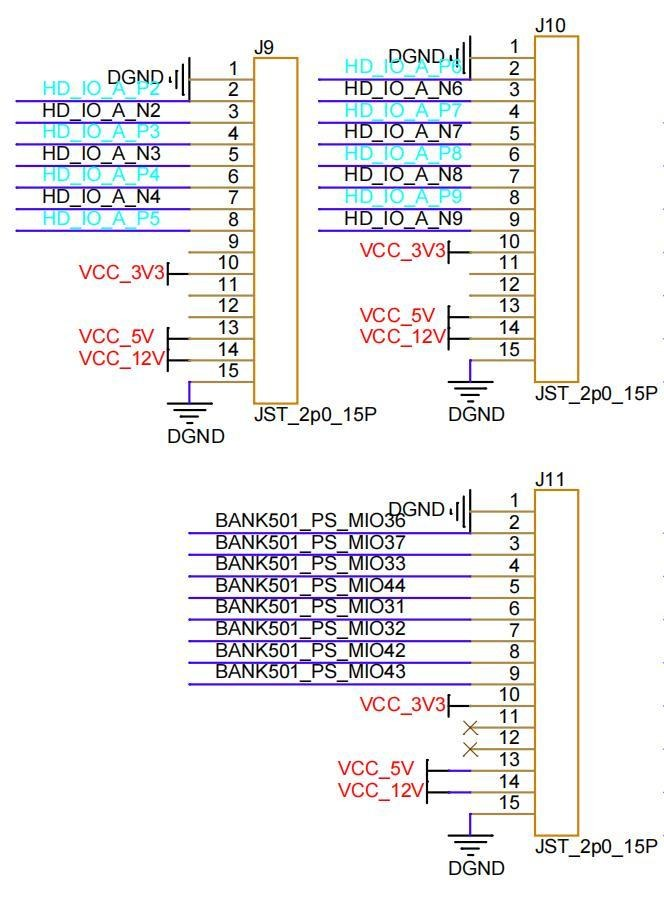

HD_IO_A_P5 IO_L7P_HDGC_88 K17
表 22 J10 扩展 IO 管脚分配
信号名称引脚名引脚号备注
HD_IO_A_P6 IO_L5P_HDGC_88 L15
HD_IO_A_N6 IO_L5N_HDGC_88 L14
HD_IO_A_P7 IO_L3P_AD13P_88 N14
HD_IO_A_N7 IO_L3N_AD13N_88 M14
HD_IO_A_P8 IO_L2P_AD14P_88 N15
HD_IO_A_N8 IO_L2N_AD14N_88 M15
HD_IO_A_P9 IO_L1P_AD15P_88 N16
HD_IO_A_N9 IO_L1N_AD15N_88 M16
表 23 J11 扩展 IO 管脚分配
信号名称引脚名引脚号备注
BANK501_PS_MIO36 PS_MIO36 E31
BANK501_PS_MIO37 PS_MIO37 E32
BANK501_PS_MIO33 PS_MIO33 D32
BANK501_PS_MIO44 PS_MIO44 K30
BANK501_PS_MIO31 PS_MIO31 D33
BANK501_PS_MIO32 PS_MIO32 D34
BANK501_PS_MIO42 PS_MIO42 H31
BANK501_PS_MIO43 PS_MIO43 G31
RFEVM216 载卡上可以扩展出 4 个用户自定义的 LED 灯,4 个扩展 IO 引到
了 2PIN 的 TJC3 直插针座上。
图 23 LED 灯扩展 IO 电路示意图
表 24 LED 灯扩展 IO 管脚分配
信号名称引脚名引脚号备注
LEDG0 IO_L12P_AD8P_88 G16
LEDG1 IO_L12N_AD8N_88 G15
LEDG2 IO_L8P_HDGC_88 J16
LEDG3 IO_L8N_HDGC_88 H16

## 3.13 启动模式配置

RFEVM216 开发板上有两个 2 位的拨码开关 SWC1 和 SWC2 来配置 ZYNQ
系统的启动模式。RFEVM216 开发平台支持 4 种启动模式，分别是 JTAG 调试模
式 、 QSPI FLASH 、 EMMC 和 SD 卡启动模式 。 RFSoC 芯片上电后会检测
（PS_MODE0~3）的电平来决定那种启动模式。用户可以同通过拨码开关 SWC1
来选择不同的启动模式。

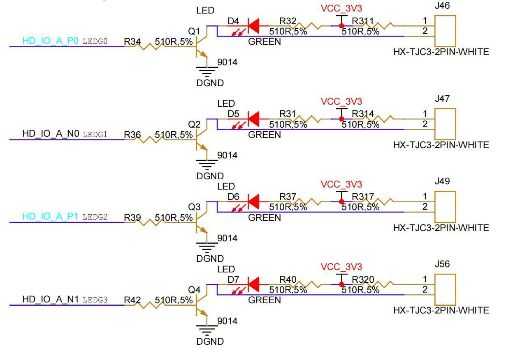

图 24 PS_MODE 电路示意图
SWC1 和 SWC2 启动模式配置如下表所示。

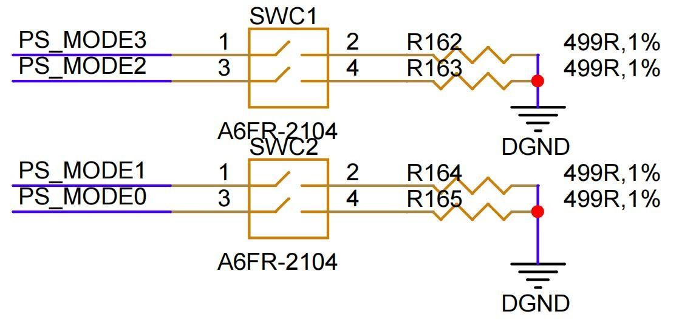

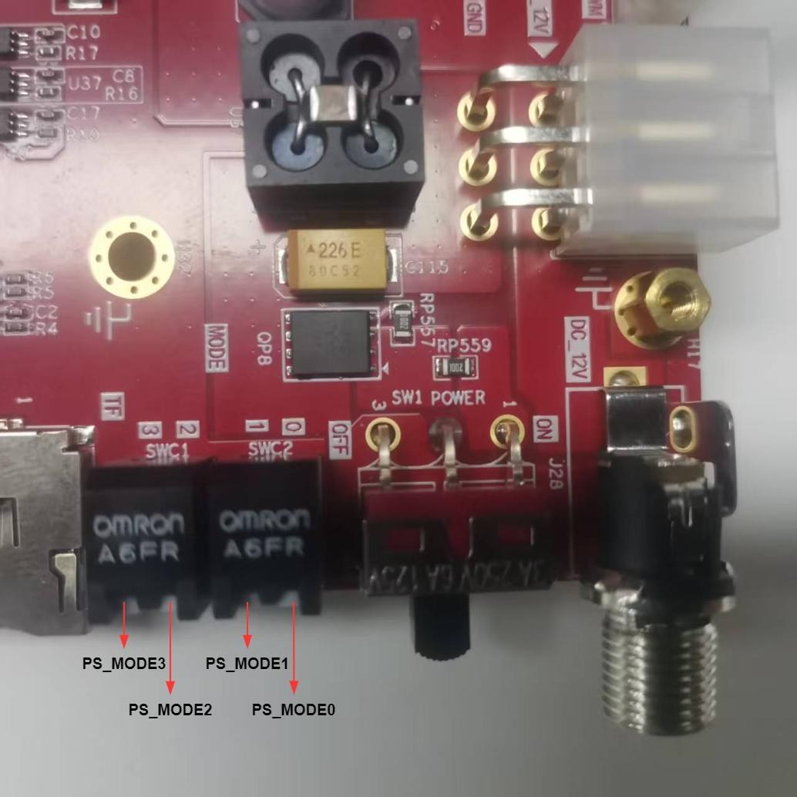

表 25 启动模式配置
拨码 SWC1 位置
（1、2）
拨码 SWC2 位置
（1、2）
MODE[3:0] 启动模式
ON，ON ON，ON 0000 JTAG
ON，ON OFF，ON 0010 QSPI
ON，OFF OFF，ON 0110 EMMC
OFF，OFF OFF，ON 1110 SD

## 3.14 RF 射频链路

RFEVM216 支持 16 路 14 位 ADC 2.5GSPS 输入，16 路 14 位 DAC 9.85GSPS
输出，单端信号输入输出，通过巴伦器件进行差分单端互转功能，完成对数据的
发送和接收。
ADC 模拟前端经过限幅二极管后，通过巴伦进行单端转差分转换，差分信
号直接连到核心板的 RF-ADC 管脚上，示意图如下所示。
DAC 链路，核心板上 RF-DAC 的差分信号通过巴伦进行差分转单端转换，
单端信号经过 DC 模块连到 MCX 射频端子上，示意图如下所示。

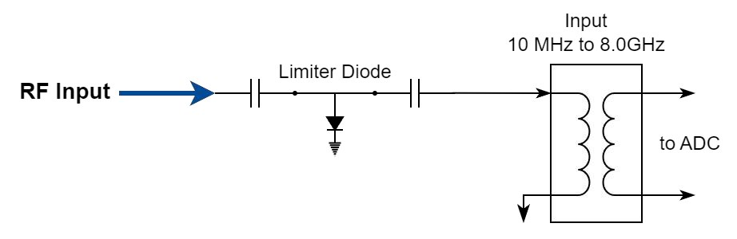

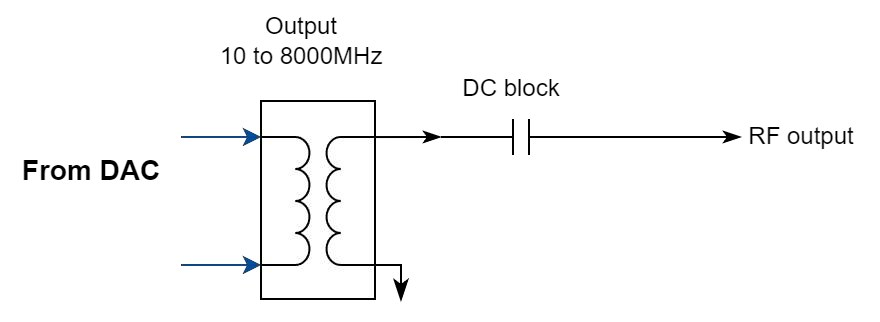

## 3.15 MMCX 接口

RFEVM216 开发板支持外参考时钟输入输出、触发信号输入输出等。实物
图如下所示。

## 3.16 风扇

RFEVM216 正常工作时会产生大量的热量，我们在核心板加装了散热结构
和风扇，防止芯片过热。风扇的转速控制由 ZYNQ 芯片的 PL 侧来控制，控制管
脚连接到了 BANK88 的 IO 上。
信号名称位号引脚号备注
CLKIN2 J27 LMK04828 参考时钟输入
CLKOUT J24 LMK04828 时钟输出
TRIG_IN JA33 H15 触发信号输入
TRIG_OUT JA34 H14 触发信号输出
ADC_CLK J25 ADC_CLK_225
DAC_CLK J26 DAC_CLK_229
CLK_IN0 J23 LMK04828 参考时钟输入
SYSREF_IN_P J21 LMK04828 参考时钟输入
SYSREF_IN_N J22 LMK04828 参考时钟输入

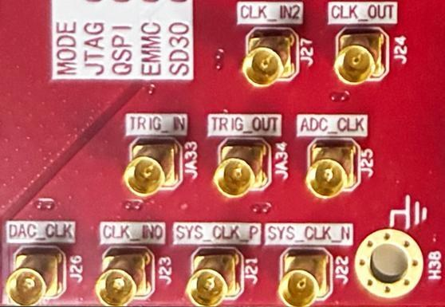

信号名称引脚名引脚号备注
HD_IO_A_N5 IO_L7N_HDGC_88 K16

## 3.17 电源

RFEVM216 开发板的电源输入电压为 DC12V，载板上通过多路电源芯片产
生+5V、+1.8V、+3.3V 电源。
电源设计框图如下图所示：
图 25 RFEVM216 载板电源接口部分

## 3.18 结构尺寸图

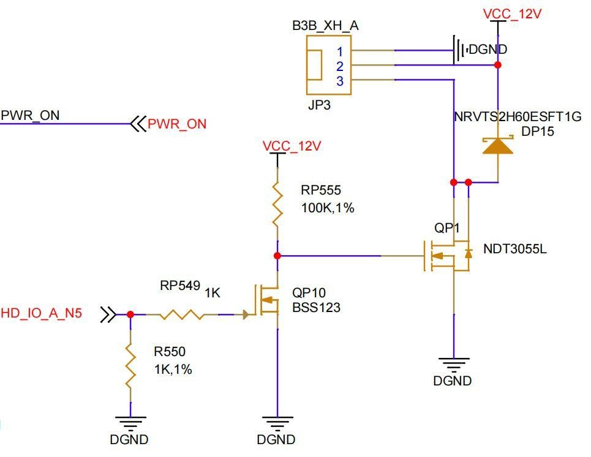

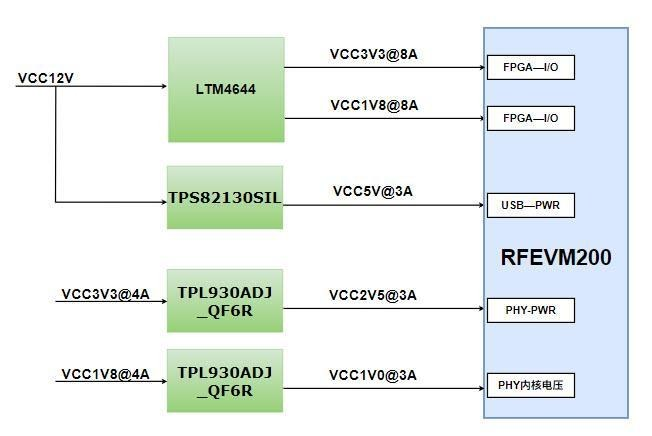

图 26 RFEVM216 正面图

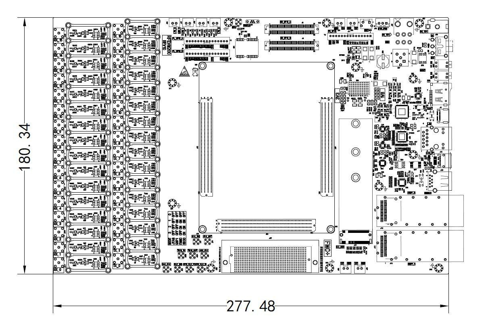
